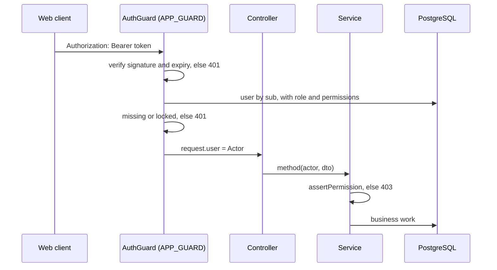

# Access control

**Owner:** Minh (C) · **Issues:** #34 (pattern), #43 (sign-in backend), #44 (sign-in UI), #70 (audit) · **Status:** built in #43 and #44; audited in #70
**Requirements:** FR-38, FR-39, FR-40 *(S)*, FR-41 *(S)*, NFR-05 · **Use cases:** UC16, UC15 *(S)*

## What already exists

Built by Tiến in the UC02 reference slice (#95) and described in
[`how-to-add-a-module.md`](how-to-add-a-module.md):

| Piece | Where | What it does |
|---|---|---|
| Roles and permissions | `src/backend/src/auth/permissions.ts` | `RoleCode`, `Permission` and `ROLE_PERMISSIONS` (Proposal Table 2.4). The seed writes them to `roles`, `permissions`, `role_permissions`; at run time they are read from the database, so UC15 can change them without a code change. |
| `Actor` | `src/backend/src/auth/actor.ts` | The signed-in user as services see it: `id`, `username`, `fullName`, `role`, `permissions`. |
| `assertPermission(actor, permission)` | same file | First statement of every service method; throws `PermissionDenied` (403, `PERMISSION_DENIED`). This is FR-39. |
| `@CurrentUser()`, `@Public()` | `src/backend/src/auth/decorators.ts` | Inject the `Actor` in a controller; mark a route that needs no user. |
| `DevAuthGuard` | `src/backend/src/auth/dev-auth.guard.ts` | With `AUTH_MODE=dev` it trusts the `X-Dev-User` header and loads that user. No password. Now used only by the e2e helper `as('pharmacist')`. |

This document covers sign-in with a password and a token (UC16), which
replaced `DevAuthGuard` for everyday use. Services and controllers did not
change.

## Permissions used by my use cases

| Use case | Action | Permission | Roles |
|---|---|---|---|
| UC09 | Open, approve, cancel a stock take | `stock_take.approve` | Manager |
| UC09 | Enter counts, submit | `stock_take.count` | Manager, Pharmacist |
| UC10, UC11 | List and acknowledge alerts; expiry list | `alert.manage` | Manager |
| UC11 | Write off, batch status, assess quarantine, record destruction | `batch_status.manage` | Manager |
| UC12 | Stock movement report | `report.view` | Manager |
| UC15 *(S)* | Users, roles, permissions, audit log | `user.manage` | Manager |
| UC16 | Sign in, sign out, `GET /auth/me` | none (sign-in is `@Public()`) | Everyone with an active account |

## Sign-in design (UC16)

### Choices

| Item | Choice | Reason |
|---|---|---|
| Password hash | `bcryptjs`, cost 10, in `User.passwordHash` | NFR-05. Pure JavaScript, so it installs on Windows without build tools (risk R12). |
| Token | JWT, HS256, payload `{ sub: user.id }`, lifetime 8 h (FR-38) | Stateless. Holds no permissions, because the guard re-reads them (below). |
| Secret | `JWT_SECRET` in `.env`; the backend refuses to start in `AUTH_MODE=jwt` without it, and refuses `AUTH_MODE=dev` when `NODE_ENV=production` | A default secret ends up being used for real. In `dev` mode without a secret a random one is used, so an old `.env` still starts. |
| Mode | `AUTH_MODE=jwt` is the default and what `.env.example` sets; `dev` is kept for the e2e tests | The 97 e2e tests written before sign-in keep using `as('pharmacist')`; `test/auth.e2e-spec.ts` runs in `jwt` mode. |
| Transport | `Authorization: Bearer <token>` | No cookie, so no CSRF handling. |
| Every request | The guard verifies the token, then loads the user **with role and permissions** from the database, as `DevAuthGuard` does today | A locked user (`isActive = false`, FR-40) or a changed role takes effect on the next request, not after 8 hours. |
| Usernames | Compared without regard to case | `Manager` and `manager` are one account. |
| Frontend storage | `sessionStorage` | Cleared when the tab closes. Readable by scripts on the page, so the page loads no third-party scripts; recorded as a limitation. |

### Endpoints

| Route | Access | Response |
|---|---|---|
| `POST /api/auth/login` `{ username, password }` | `@Public()` | 200 `{ accessToken, expiresAt, user: { id, username, fullName, role, permissions } }` |
| `GET /api/auth/me` | signed in | Already exists; unchanged. The UI calls it after a reload to rebuild the menu. |
| `POST /api/auth/logout` | signed in | 204. The client discards the token; writes the audit entry if FR-41 is built. |

### Failures, using the existing `DomainError` classes

| Situation | Error | HTTP | Message |
|---|---|---|---|
| Field empty | `ValidationFailed` (DTO) | 400 | Next to the field |
| Unknown username **or** wrong password | `Unauthenticated` | 401 | "Incorrect username or password." The same for both (FR-38, TC-42). The service still runs one bcrypt comparison when the username is unknown, so both cases take about as long. |
| Correct password, account locked | `Unauthenticated` | 401 | "This account is locked. Ask the manager." Shown only to someone who knows the password (FR-40, TC-42). |
| No token, bad signature, expired | `Unauthenticated` | 401 | The UI clears the token and shows the sign-in page (TC-43). |
| Valid token, user since locked | `Unauthenticated` | 401 | As above. |
| Signed in, permission missing | `PermissionDenied` | 403 | From `assertPermission` (TC-28, TC-53). |

### Sign-in sequence

```mermaid
sequenceDiagram
    actor U as User
    participant W as Web client
    participant C as AuthController
    participant S as AuthService
    participant DB as PostgreSQL

    U->>W: username, password
    W->>C: POST /api/auth/login
    C->>C: LoginDto validation
    C->>S: login(username, password)
    S->>DB: user by lower(username), with role and permissions
    alt unknown user
        S->>S: bcrypt.compare against a fixed dummy hash
        S-->>W: 401 "Incorrect username or password."
    else wrong password
        S-->>W: 401 "Incorrect username or password."
    else locked
        S-->>W: 401 "This account is locked."
    else success
        S->>DB: set lastLoginAt
        S->>S: sign JWT { sub }, 8 h
        S-->>W: 200 token + user + permissions
        W->>W: keep token in sessionStorage; menu from permissions
    end
```

### A request after sign-in



## Where it lives

| Where | What |
|---|---|
| `src/backend/src/auth/auth.guard.ts` | `AuthGuard`, the `APP_GUARD`: `@Public()` routes pass; `dev` mode delegates to `DevAuthGuard`; otherwise the Bearer token |
| `src/backend/src/auth/auth.service.ts` | `login()` and `actorFromToken()` |
| `src/backend/src/auth/auth-config.ts`, `passwords.ts` | `AUTH_MODE`, `JWT_SECRET` checks, the 8-hour lifetime; bcrypt cost 10 |
| `src/backend/src/seed/access-control.seed.ts` | Sample accounts get a bcrypt hash of `SEED_PASSWORD`, hashed once per run. An account still holding the old placeholder `!` is upgraded; a password already set is kept. The seed is kept by Tiến (CODEOWNERS) |
| `src/frontend/src/auth/` | `AuthProvider` (session in `sessionStorage`, sign-out at expiry), `useAuth()`, route guards, the screen-to-permission map |
| `src/frontend/src/api/client.ts` | Sends the token; a 401 ends the session and returns to sign-in |
| `src/frontend/src/pages/LoginPage.tsx` | The sign-in page |

## Audit (FR-41, Should)

If UC15 is built, these go to `audit_logs` with user and time:
`auth.login`, `auth.login_failed` (username tried, never the password),
`auth.logout`, user and role changes, and approved stock takes (UC09).

## Tests

In `test/auth.e2e-spec.ts` (UC16-01 to UC16-13) and `auth-config.spec.ts`:

| Test | Covers |
|---|---|
| Sign-in returns token, 8-hour expiry and permissions; username case ignored | FR-38 |
| Wrong password and unknown user give the same 401 body | FR-38, TC-42 |
| Locked account refused; "locked" only after the right password; an existing token stops working | FR-40, TC-42 |
| Missing, malformed and expired tokens refused; `X-Dev-User` ignored in `jwt` mode | FR-38, TC-43, NFR-05 |
| A cashier signed in for real gets 403 on dispensing and supplier changes | FR-39, TC-28 |
| Stored hashes are bcrypt cost 10; the seed keeps a changed password | NFR-05 |
| `jwt` mode refuses to start without `JWT_SECRET`; `dev` refused in production | NFR-05 |

TC-53 (every role × every endpoint) is in `test/access-matrix.e2e-spec.ts`;
see the table below.

## Endpoint → permission table (TC-53, #70)

Every route the API serves (67 with #105's assessment and destruction routes), the permission its service checks, and what each
role gets. "✓" means the role is let through (it may still get 400, 404, 409
or 422 for business reasons); "403" means `PERMISSION_DENIED`. Roles follow
`ROLE_PERMISSIONS` in `src/backend/src/auth/permissions.ts` (Proposal
Table 2.4). Without a valid token every route except sign-in answers 401.

`test/access-matrix.e2e-spec.ts` sends each of these calls as each role with
a valid body and real ids, and checks exactly this. It also reads the routes
the running app registers and fails if one is missing from the test, so a new
endpoint cannot be added without a row there and here. `GET /api/reports/:kind`
is one route serving three reports; each report checks its own permission, so
all three are listed. The two `stock-movement` routes need `?from=&to=`.

| Method | Route | Permission | Manager | Pharmacist | Cashier |
|---|---|---|---|---|---|
| POST | `/api/auth/login` | none (`@Public()`) | ✓ | ✓ | ✓ |
| GET | `/api/auth/me` | signed in | ✓ | ✓ | ✓ |
| POST | `/api/auth/logout` | signed in | ✓ | ✓ | ✓ |
| GET | `/api/medicines` | `stock.view` | ✓ | ✓ | ✓ |
| GET | `/api/medicines/reference-data` | `stock.view` | ✓ | ✓ | ✓ |
| GET | `/api/medicines/:id` | `stock.view` | ✓ | ✓ | ✓ |
| POST | `/api/medicines` | `catalogue.manage` | ✓ | 403 | 403 |
| PATCH | `/api/medicines/:id` | `catalogue.manage` | ✓ | 403 | 403 |
| POST | `/api/medicines/:id/deactivate` | `catalogue.manage` | ✓ | 403 | 403 |
| POST | `/api/medicines/:id/activate` | `catalogue.manage` | ✓ | 403 | 403 |
| GET | `/api/stock` | `stock.view` | ✓ | ✓ | ✓ |
| GET | `/api/stock/medicines/:id` | `stock.view` | ✓ | ✓ | ✓ |
| GET | `/api/stock/batches/:id/movements` | `stock.view` | ✓ | ✓ | ✓ |
| GET | `/api/suppliers` | `supplier.manage` | ✓ | 403 | 403 |
| GET | `/api/suppliers/:id` | `supplier.manage` | ✓ | 403 | 403 |
| POST | `/api/suppliers` | `supplier.manage` | ✓ | 403 | 403 |
| PATCH | `/api/suppliers/:id` | `supplier.manage` | ✓ | 403 | 403 |
| POST | `/api/suppliers/:id/deactivate` | `supplier.manage` | ✓ | 403 | 403 |
| POST | `/api/suppliers/:id/activate` | `supplier.manage` | ✓ | 403 | 403 |
| GET | `/api/goods-receipts` | `goods_receipt.create` | ✓ | 403 | 403 |
| GET | `/api/goods-receipts/:id` | `goods_receipt.create` | ✓ | 403 | 403 |
| POST | `/api/goods-receipts` | `goods_receipt.create` | ✓ | 403 | 403 |
| GET | `/api/customers` | `prescription.manage` | ✓ | ✓ | 403 |
| GET | `/api/customers/:id` | `prescription.manage` | ✓ | ✓ | 403 |
| POST | `/api/customers` | `prescription.manage` | ✓ | ✓ | 403 |
| PATCH | `/api/customers/:id` | `prescription.manage` | ✓ | ✓ | 403 |
| GET | `/api/prescribers` | `prescription.manage` | ✓ | ✓ | 403 |
| GET | `/api/prescribers/:id` | `prescription.manage` | ✓ | ✓ | 403 |
| POST | `/api/prescribers` | `prescription.manage` | ✓ | ✓ | 403 |
| PATCH | `/api/prescribers/:id` | `prescription.manage` | ✓ | ✓ | 403 |
| POST | `/api/prescribers/:id/deactivate` | `prescription.manage` | ✓ | ✓ | 403 |
| POST | `/api/prescribers/:id/activate` | `prescription.manage` | ✓ | ✓ | 403 |
| GET | `/api/prescriptions` | `prescription.manage` | ✓ | ✓ | 403 |
| GET | `/api/prescriptions/:id` | `prescription.manage` | ✓ | ✓ | 403 |
| POST | `/api/prescriptions` | `prescription.manage` | ✓ | ✓ | 403 |
| PUT | `/api/prescriptions/:id` | `prescription.manage` | ✓ | ✓ | 403 |
| POST | `/api/prescriptions/:id/verify` | `prescription.manage` | ✓ | ✓ | 403 |
| POST | `/api/dispensings/preview` | `dispense` | ✓ | ✓ | 403 |
| POST | `/api/dispensings` | `dispense` | ✓ | ✓ | 403 |
| POST | `/api/sales` | `sale.create` | ✓ | 403 | ✓ |
| GET | `/api/sales/billable` | `sale.create` | ✓ | 403 | ✓ |
| GET | `/api/sales/:id` | `sale.create` | ✓ | 403 | ✓ |
| GET | `/api/returns/sales/:receiptNumber` | `return.create` | ✓ | 403 | ✓ |
| POST | `/api/returns` | `return.create` | ✓ | 403 | ✓ |
| GET | `/api/returns/:id` | `return.create` | ✓ | 403 | ✓ |
| GET | `/api/stock-takes` | `stock_take.count` | ✓ | ✓ | 403 |
| POST | `/api/stock-takes` | `stock_take.approve` | ✓ | 403 | 403 |
| GET | `/api/stock-takes/:id` | `stock_take.count` | ✓ | ✓ | 403 |
| PUT | `/api/stock-takes/:id/lines/:lineId` | `stock_take.count` | ✓ | ✓ | 403 |
| POST | `/api/stock-takes/:id/lines` | `stock_take.count` | ✓ | ✓ | 403 |
| POST | `/api/stock-takes/:id/submit` | `stock_take.count` | ✓ | ✓ | 403 |
| POST | `/api/stock-takes/:id/approve` | `stock_take.approve` | ✓ | 403 | 403 |
| POST | `/api/stock-takes/:id/return` | `stock_take.approve` | ✓ | 403 | 403 |
| POST | `/api/stock-takes/:id/cancel` | `stock_take.approve` | ✓ | 403 | 403 |
| GET | `/api/alerts` | `alert.manage` | ✓ | 403 | 403 |
| POST | `/api/alerts/:id/acknowledge` | `alert.manage` | ✓ | 403 | 403 |
| POST | `/api/batches/:id/status` | `batch_status.manage` | ✓ | 403 | 403 |
| POST | `/api/batches/:id/write-off` | `batch_status.manage` | ✓ | 403 | 403 |
| GET | `/api/batches/pending-destruction` | `batch_status.manage` | ✓ | 403 | 403 |
| GET | `/api/batches/:id/destructions` | `batch_status.manage` | ✓ | 403 | 403 |
| POST | `/api/batches/:id/destructions` | `batch_status.manage` | ✓ | 403 | 403 |
| GET | `/api/quarantine` | `batch_status.manage` | ✓ | 403 | 403 |
| POST | `/api/quarantine/:id/assess` | `batch_status.manage` | ✓ | 403 | 403 |
| GET | `/api/reports/stock-movement` | `report.view` | ✓ | 403 | 403 |
| GET | `/api/reports/low-stock` | `alert.manage` | ✓ | 403 | 403 |
| GET | `/api/reports/expiry` | `alert.manage` | ✓ | 403 | 403 |
| GET | `/api/reports/stock-movement/medicines/:id` | `report.view` | ✓ | 403 | 403 |

## Limitations

- **Sign-out does not revoke the token on the server.** A copied token stays
  valid until it expires (at most 8 h). Re-reading the user on every request
  means a locked account stops at once.
- **No lockout after repeated failed sign-ins.** Not in any FR.
- **`sessionStorage` is readable by scripts on the page.** See the table above.
