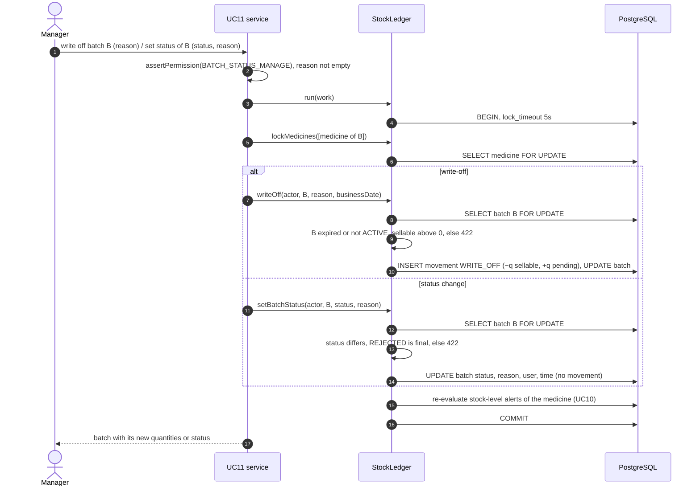

# Stock ledger

`src/backend/src/stock/stock-ledger.ts` is the only code that changes stock
(BR05, FR-12). It implements the concurrency protocol of Proposal v1.1 §3.1.
Every PR that uses it carries the `stock-integrity` label.

## Using it

```ts
await this.ledger.run(async (tx) => {
  await tx.lockMedicines([medicineId]);                         // 1. parents, ascending id
  const batches = await tx.lockEligibleBatches(medicineId, this.clock.today()); // 2. FEFO order
  // … decide quantities from the locked rows (FefoAllocator, BR01) …
  await tx.post(actor, {                                        // 3. one movement per change
    batchId: batches[0].id,
    type: MovementType.DISPENSE,
    deltaSellable: -3,
    sourceDocumentType: SourceDocumentType.DISPENSE_LINE,
    sourceDocumentId: line.id,
  });
  // save the document rows with tx.manager in the same transaction
});
```

| Method | Step | Notes |
|---|---|---|
| `run(work)` | — | One READ COMMITTED transaction, `lock_timeout = 5s`. A deadlock (40P01) retries the whole `work` once; a timeout becomes 409 *busy*. Any error rolls back everything (FR-09). |
| `lockMedicines(ids)` | 1 | `SELECT … FOR UPDATE` in ascending id. Must come before any batch lock; the transaction throws otherwise. |
| `lockBatches(ids)` | 2 | Specific batches, ascending id, fresh quantities. |
| `lockEligibleBatches(medicineId, date)` | 2 | ACTIVE, `expiryDate > date`, `qtySellable > 0`, ordered by expiry, first received, batch number, id (DEC-01, DEC-07). |
| `lockBatchByNumber(medicineId, number)` / `createBatch(input)` | 2 | Goods receipts: top up an existing batch or create one. |
| `post(actor, input)` | 3 | Batch must be locked in this transaction. Applies the deltas, refuses BR03 (no state below zero), writes the movement. |
| `reverse(actor, movementId, reason)` | 1–3 | The exact opposite movement, referencing the original; once only; a reversal cannot be reversed. |

`tx.manager` is the transaction's `EntityManager`: write the document
(receipt, dispense lines, sale) with it so the document and its movements
commit or roll back together.

## Movement types and signs

The database CHECK `ck_stock_movements_sign_by_type` enforces these; a
reversal (with `reversesMovement`) is exempt because it is the negation.

| Type | Sellable | Quarantine | Pending destruction |
|---|---|---|---|
| RECEIPT | + | | |
| DISPENSE, SALE | − | | |
| RETURN | | + | |
| RELEASE | + | − (same amount) | |
| REJECT | | − | + (same amount) |
| WRITE_OFF | − | | + (same amount) |
| DESTROY | | | − |
| ADJUSTMENT | ± | | |

## Safety nets

- CHECK constraints: no batch quantity below zero; movement signs per type.
- Trigger: `stock_movements` refuses UPDATE and DELETE.
- Unique `reverses_movement_id`: a movement is reversed at most once.
- `findLedgerMismatches()` (`stock/ledger-invariant.ts`): cached quantity =
  sum of movements for every batch and state. Call it at the end of every e2e
  test that changes stock.

## Tests

`src/stock/stock-deltas.spec.ts` (BR03 and reversal arithmetic, the business
clock) and `test/stock-ledger.e2e-spec.ts` (every movement type keeps the
invariant, reversal once, rollback of a whole command, lock order, eligible
batches in FEFO order, and a race for the last units repeated five times).

## Week 7: batch status and quarantine commands (design gate for #55)

*Designed 22/10/2026, built 23/10 (#55).* UC08 (returns, Duy Anh) and UC11
(expiry and batch status, Minh) need these commands; they are built first in
week 7 so both use cases can start from them (plan `tuan-07.md`, W07-A1). The
rules live here, in the ledger, so no use case can forget one.

### Contract

New methods on `LedgerTransaction`. Each locks the batch's medicine (unless
the transaction already holds it) and then the batch, like `reverse`, so call
it before locking another medicine's batches. Each writes at most one
movement; status and reason are stored on the batch. An empty reason is a
400 on `reason` (`ValidationFailed`); expiry is judged against the
`businessDate` the caller passes from its `Clock`.

| Method | Caller | Rule it enforces | Movement | Refused with |
|---|---|---|---|---|
| `setBatchStatus(actor, batchId, status, reason)` | UC11 (Minh) | A reason is required. ACTIVE ↔ ON_HOLD ↔ RECALLED both ways; **REJECTED is final**. Stores `statusReason`, `statusChangedBy`, `statusChangedAt` (DEC-07, FR-48) | none — a batch that is not ACTIVE simply stops being eligible | 400 `reason`; 422 `BATCH_STATUS_UNCHANGED`, `BATCH_REJECTED_FINAL` |
| `receiveReturn(actor, batchId, quantity, returnLineId)` | UC08 (Duy Anh) | Into **quarantine** of the batch the item was sold from, whatever its status or expiry (DEC-04, BR11; UC08 A6). How many may be returned is UC08's check on the sale line, not the ledger's | RETURN: quarantine +q | BR03 never applies (adds stock) |
| `writeOff(actor, batchId, reason, businessDate)` | UC11 (Minh) | The whole sellable quantity of a batch that is **expired or not ACTIVE**; a reason is required. Damaged stock of an active batch is an adjustment in UC09, not a write-off | WRITE_OFF: sellable −q, pending destruction +q | 400 `reason`; 422 `NOTHING_TO_WRITE_OFF`, `BATCH_STILL_SELLABLE` |
| `release(actor, batchId, quantity, returnLineId, businessDate)` *(S, FR-46)* | UC11 assessment | Only when the batch is ACTIVE and not expired and the medicine is not controlled (DEC-04) | RELEASE: quarantine −q, sellable +q | 422 `CANNOT_RELEASE`; BR03 if more than quarantined |
| `reject(actor, batchId, quantity, returnLineId)` *(S, FR-46)* | UC11 assessment | Any quarantined quantity | REJECT: quarantine −q, pending destruction +q | BR03 if more than quarantined |
| `destroy(actor, batchId, quantity, reason)` *(S, FR-47)* | UC11 destruction record | A reason (who witnessed, how) is required | DESTROY: pending destruction −q | 400 `reason`; BR03 if more than pending |

Source documents: RETURN, RELEASE and REJECT point to the return line;
WRITE_OFF and DESTROY point to the batch (`SourceDocumentType.BATCH`) and
carry the reason on the movement. The signs are already checked by the
database (table above). Stock-level alerts are re-evaluated at the end of
`run()` for every locked medicine (UC10, #147), so a status change or a
write-off updates them without extra calls.

### Sequence — write-off and status change (UC11)



The return path (UC08) is drawn in
[sequence diagram 3](../diagrams/sequence-diagrams.md): the sale lines are
locked first, then the medicines, then `receiveReturn` per line.

### Scenario table

Each row becomes a test in `test/stock-ledger.e2e-spec.ts`; after every one,
`findLedgerMismatches` finds nothing (BR05).

| ID | Scenario | Expected |
|---|---|---|
| LEDGER-W7-01 | Put an ACTIVE batch on hold with a reason, then back to ACTIVE | Status, reason, user and time stored; not eligible while on hold; no movement |
| LEDGER-W7-02 | Status change without a reason; to the same status; from REJECTED | 400 / 422 `BATCH_STATUS_UNCHANGED` / 422 `BATCH_REJECTED_FINAL` |
| LEDGER-W7-03 | Return 2 into an expired, recalled batch | RETURN +2 quarantine; sellable unchanged |
| LEDGER-W7-04 | Write off an expired batch with 5 sellable | WRITE_OFF: sellable 0, pending destruction 5 |
| LEDGER-W7-05 | Write off an active, unexpired batch; a batch with 0 sellable | 422 `BATCH_STILL_SELLABLE` / `NOTHING_TO_WRITE_OFF` |
| LEDGER-W7-06 *(S)* | Release 2 of a non-controlled, unexpired return; release from an expired batch or of a controlled medicine | RELEASE moves 2 to sellable / 422 `CANNOT_RELEASE` |
| LEDGER-W7-07 *(S)* | Reject 2; reject 3 with 2 in quarantine | REJECT to pending destruction / BR03 refused |
| LEDGER-W7-08 *(S)* | Destroy 5 pending with a reason; destroy more than pending | DESTROY / BR03 refused |
| LEDGER-W7-09 | Status change while a sale holds the medicine lock | Waits for the sale, then applies; no deadlock (lock order) |
| LEDGER-W7-10 | Two commands on one batch overlapping inside one transaction; the batch id in upper case | One cached batch: quarantine 1 + 2 = 3; REJECTED then ON_HOLD → the second refused `BATCH_REJECTED_FINAL` |

Manual cases using these commands are run with UC08 (TC-16, 50) and UC11
(TC-22, 56, 60).
