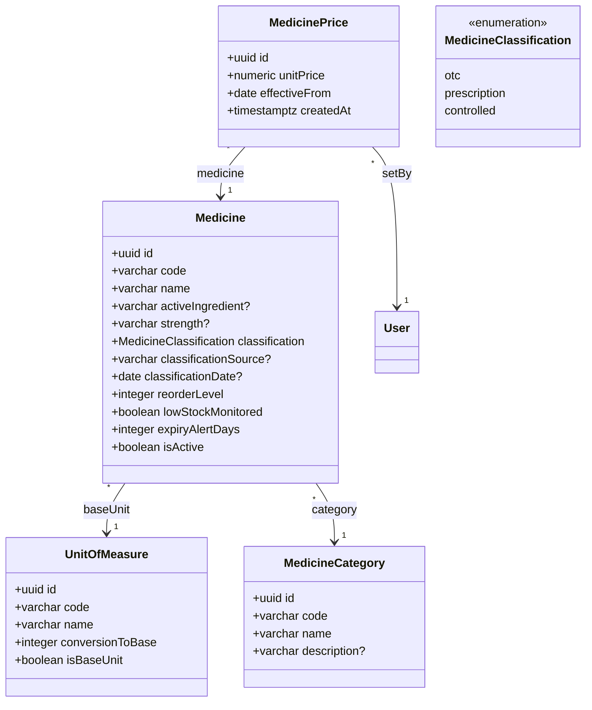
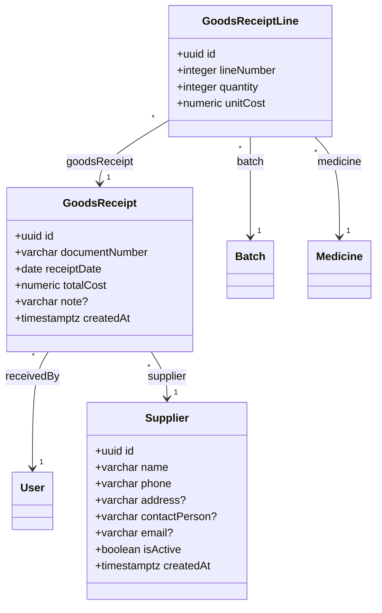
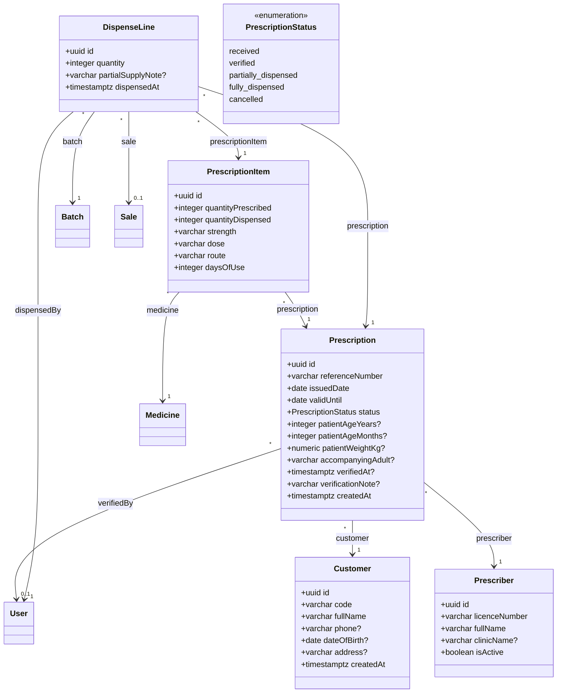
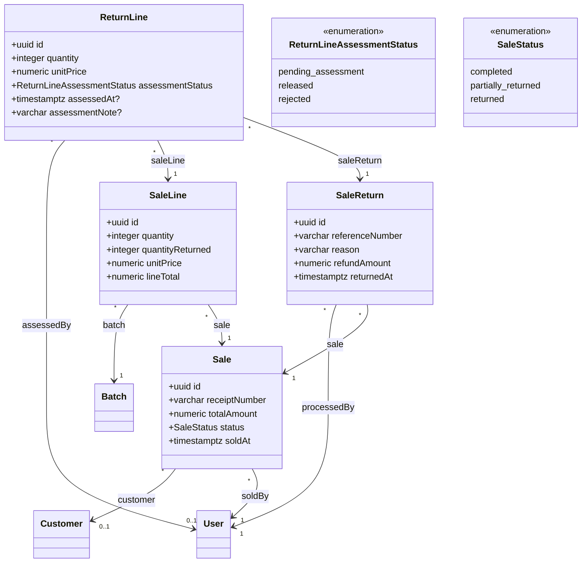
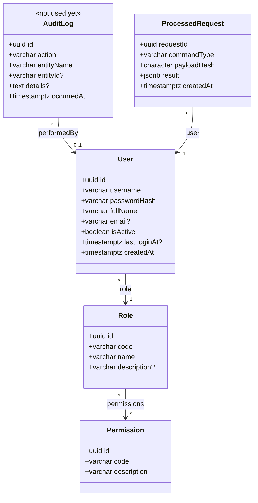
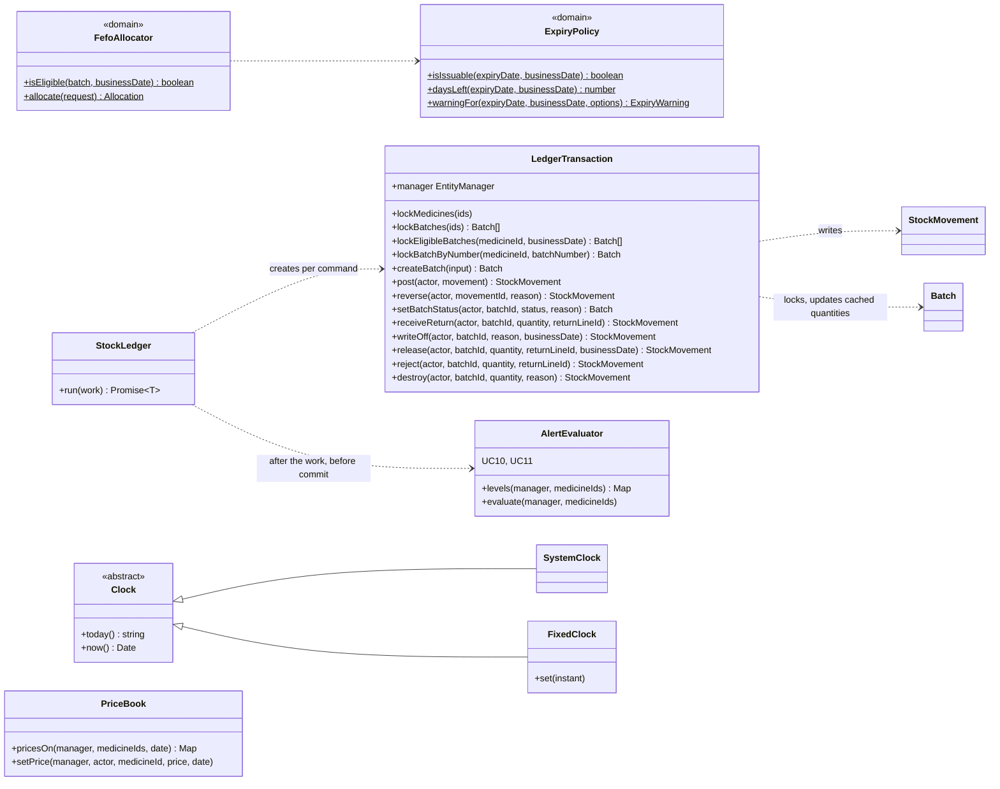
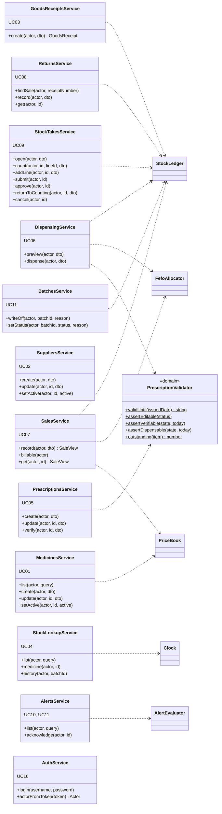
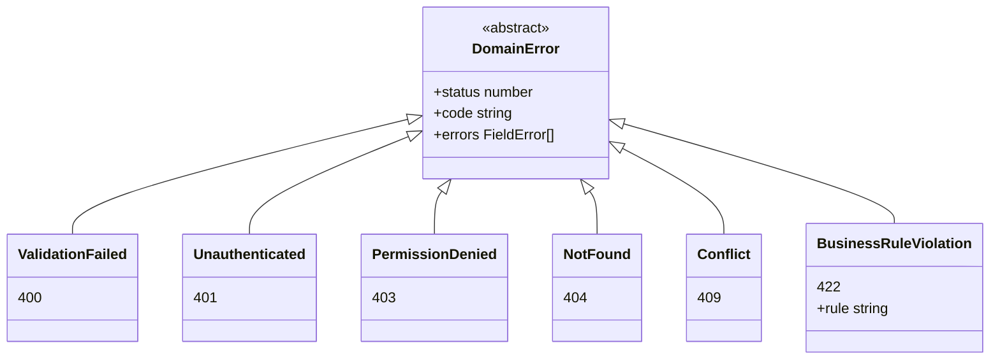
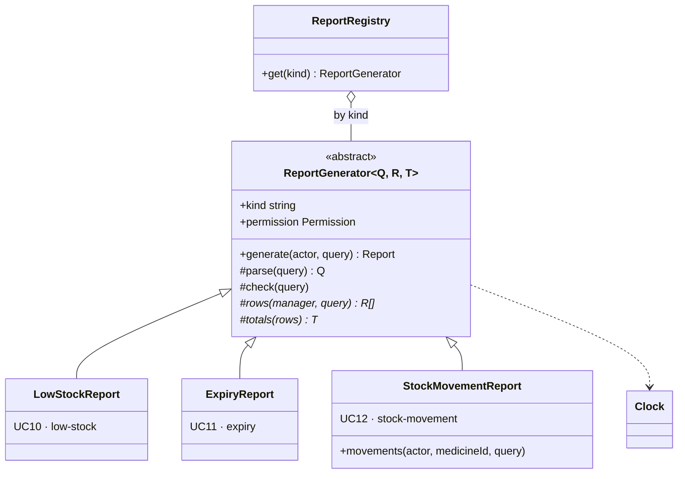

# Class diagram

> Generated from the TypeORM entities by `npm run diagrams` in `src/backend`.
> Do not edit by hand; change the entity and run it again.

Part 1 shows the persistent classes (TypeORM entities) with their attributes, enumerations and associations, generated. Part 2, below the marker, shows the services and domain classes that hold the business rules; it is written by hand.

## Part 1 — Entities (generated)

Marked <<not used yet>>, because nothing in the application reads or writes them so far:

- `AuditLog`: Only the demo seed writes one row, as its completion marker. The audit entries of FR-41 come with UC15 (#105).

### Catalogue

### Purchasing

### Stock and control

```mermaid
classDiagram
    class Batch {
        +uuid id
        +varchar batchNumber
        +date expiryDate
        +integer qtySellable
        +integer qtyQuarantine
        +integer qtyPendingDestruction
        +BatchStatus status
        +varchar statusReason?
        +timestamptz statusChangedAt?
        +numeric unitCost
        +timestamptz receivedAt
        +timestamptz createdAt
    }
    class StockMovement {
        +uuid id
        +StockMovementType type
        +integer deltaSellable
        +integer deltaQuarantine
        +integer deltaPendingDestruction
        +varchar reason?
        +StockMovementSourceDocumentType sourceDocumentType
        +uuid sourceDocumentId
        +timestamptz occurredAt
    }
    class StockTake {
        +uuid id
        +varchar referenceNumber
        +StockTakeStatus status
        +varchar note?
        +timestamptz submittedAt?
        +timestamptz approvedAt?
        +timestamptz createdAt
    }
    class StockTakeLine {
        +uuid id
        +integer systemQuantity
        +integer countedQuantity?
        +varchar reason?
    }
    class StockTakeMedicine {
    }
    class StockTakeCounter {
    }
    class StockAlert {
        +uuid id
        +StockAlertType type
        +StockAlertStatus status
        +varchar message
        +timestamptz acknowledgedAt?
        +timestamptz resolvedAt?
        +timestamptz raisedAt
    }
    Batch "*" --> "1" Medicine : medicine
    Batch "*" --> "0..1" User : statusChangedBy
    StockMovement "*" --> "1" Batch : batch
    StockMovement "*" --> "1" User : performedBy
    StockMovement "0..1" --> "0..1" StockMovement : reversesMovement
    StockTake "*" --> "0..1" User : approvedBy
    StockTake "*" --> "0..1" User : countedBy
    StockTake "*" --> "1" User : openedBy
    StockTakeLine "*" --> "1" Batch : batch
    StockTakeLine "*" --> "0..1" User : countedBy
    StockTakeLine "*" --> "1" StockTake : stockTake
    StockTakeMedicine "*" --> "1" Medicine : medicine
    StockTakeMedicine "*" --> "1" StockTake : stockTake
    StockTakeCounter "*" --> "1" StockTake : stockTake
    StockTakeCounter "*" --> "1" User : user
    StockAlert "*" --> "0..1" User : acknowledgedBy
    StockAlert "*" --> "0..1" Batch : batch
    StockAlert "*" --> "1" Medicine : medicine
    class BatchStatus {
        <<enumeration>>
        active
        on_hold
        recalled
        rejected
    }
    class StockAlertStatus {
        <<enumeration>>
        open
        acknowledged
        resolved
    }
    class StockAlertType {
        <<enumeration>>
        low_stock
        out_of_stock
        expiring_soon
        expired
    }
    class StockMovementSourceDocumentType {
        <<enumeration>>
        goods_receipt
        dispense_line
        sale_line
        return_line
        stock_take_line
        batch
    }
    class StockMovementType {
        <<enumeration>>
        receipt
        dispense
        sale
        return
        release
        reject
        write_off
        destroy
        adjustment
    }
    class StockTakeStatus {
        <<enumeration>>
        counting
        pending_approval
        approved
        cancelled
    }
```

### Prescriptions and dispensing

### Sales and returns

### Access and infrastructure

<!-- END GENERATED -->

## Part 2 — Services and domain classes (written by hand)

The business rules live in these classes, not in the entities or the
controllers (NFR-11). Kept small on purpose: each box shows the operations
other classes call. Checked against the code on 29/10/2026 (#71):
everything shown is on `main`.

### Stock: the ledger and the rules it applies

Every change of stock goes through `StockLedger.run`, one transaction with a
fixed lock order (medicines, then batches) — see
[`stock-ledger.md`](../design/stock-ledger.md) and the sequence diagrams.

### Use-case services

Each service checks the permission, validates against the rules and, when
stock moves, calls the ledger. Controllers only translate HTTP.

### Errors: one hierarchy, one response shape

Services throw these; `AllExceptionsFilter` turns any of them into
`{ statusCode, code, message, errors }` (see
[`error-handling.md`](../design/error-handling.md)).

### Reports (UC10–UC12)

Decision D14 of the plan: one abstract report, three kinds, so the same
route and screen code serve all of them. `GET /api/reports/:kind` asks
`ReportRegistry` for the generator; `generate` is a template method: it
checks the permission, validates the query, runs the subclass's `check`,
`rows` and `totals`, and stamps who produced it and when.

