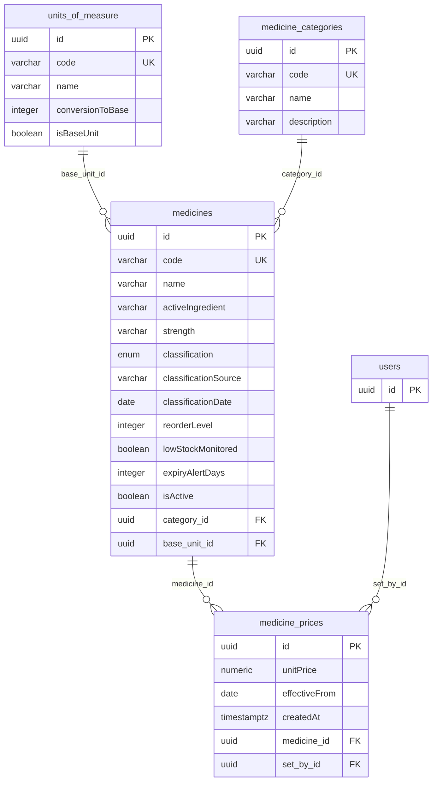
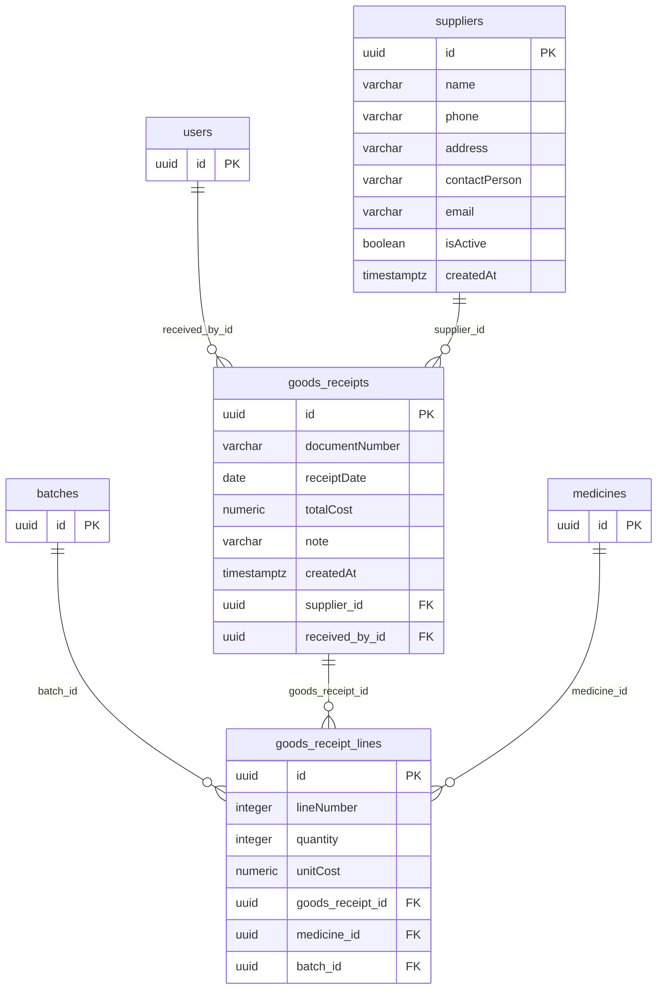
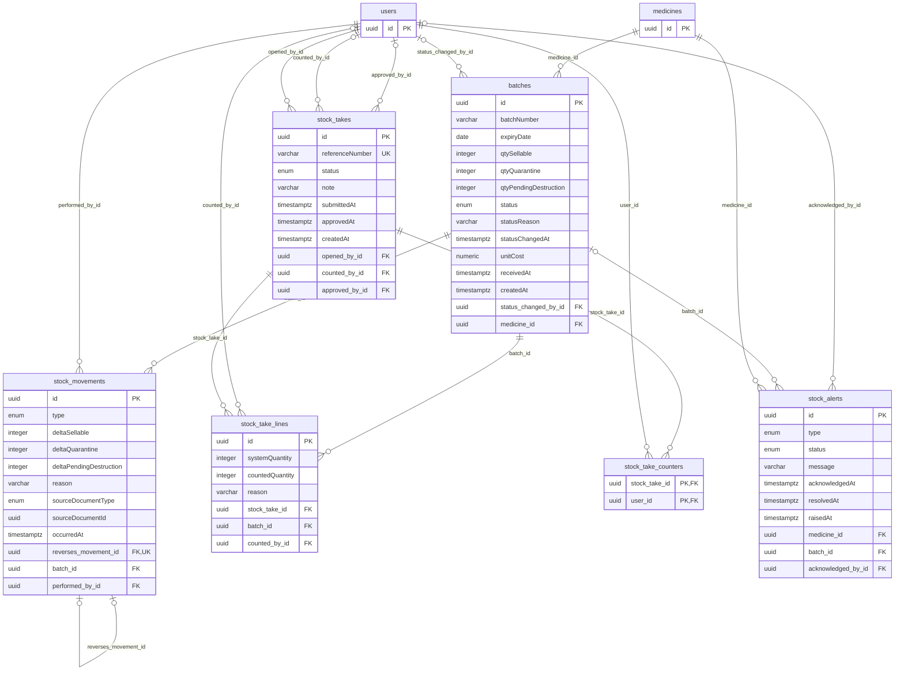
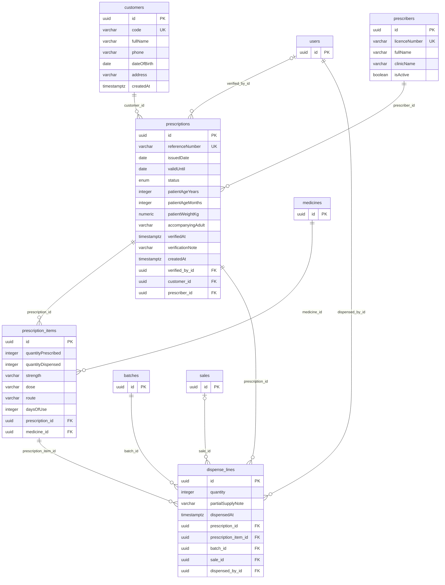
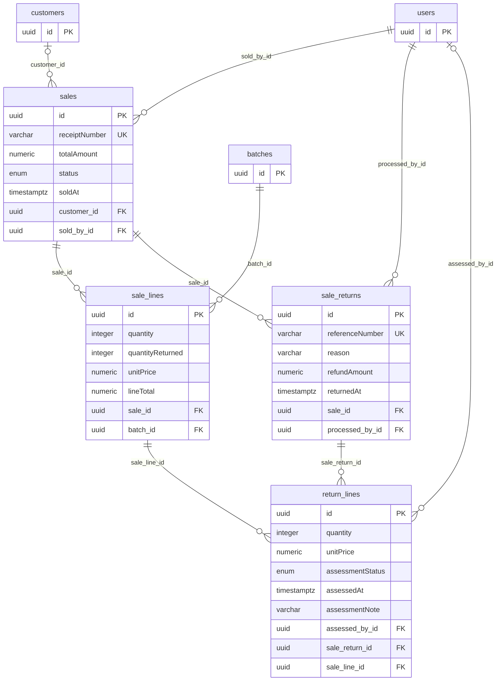
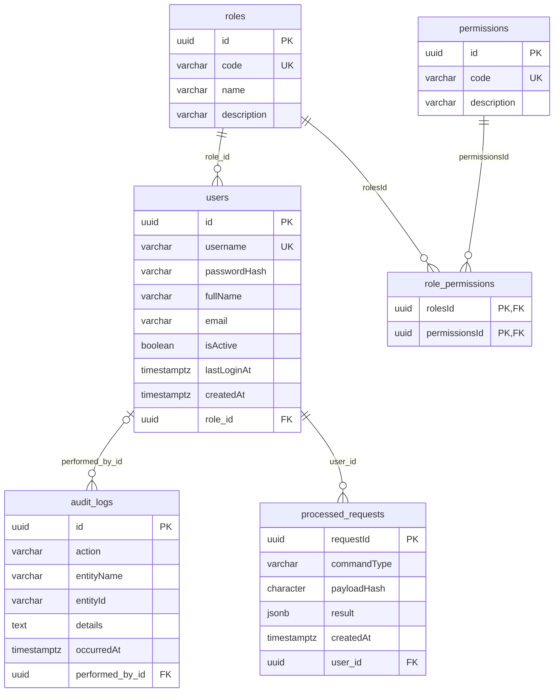

# Entity–relationship diagram

> Generated from the TypeORM entities by `npm run diagrams` in `src/backend`.
> Do not edit by hand; change the entity and run it again.

28 tables in six subsystems. Crow's feet read as usual: `||--o{` is one parent to zero or more children; `|o` marks an optional parent (nullable foreign key). A table from another subsystem appears as a stub with its key only.

### Catalogue

### Purchasing

### Stock and control

### Prescriptions and dispensing

### Sales and returns

### Access and infrastructure

## Links the database does not enforce

- StockMovement.sourceDocumentType + sourceDocumentId point to the receipt, dispense line, sale line, return line or stock-take line that caused the movement. They are not a foreign key: one column pair serves five tables.
- Two triggers written by hand in the initial migration guard `stock_movements`: `stock_movements_append_only` refuses UPDATE and DELETE (BR05), and `stock_movements_check_reversal` checks that a reversal is the exact negation of the movement it reverses.
