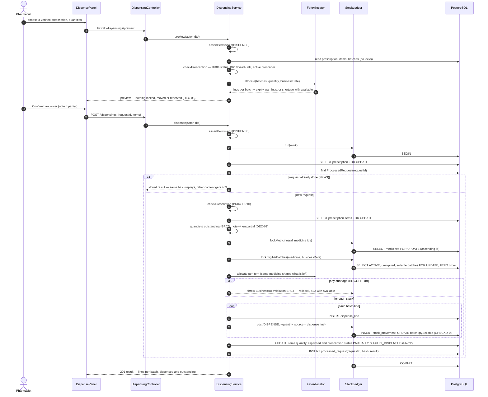
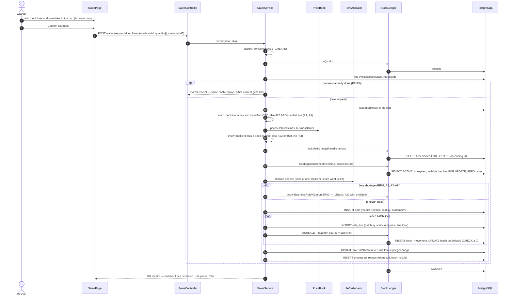
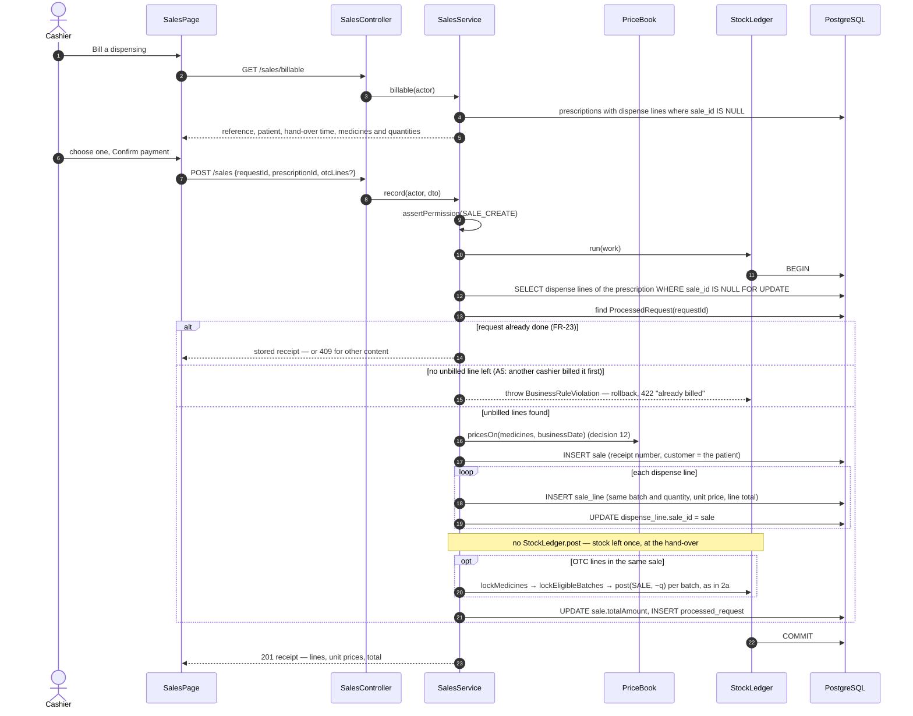
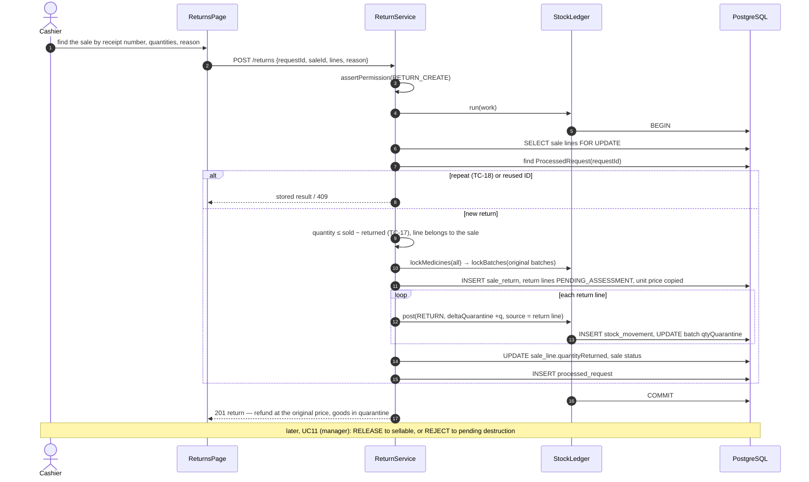

# Sequence diagrams — dispensing, billing, returns

Week 4 task W04-B1 (#31), done late. Three flows where stock and money meet,
drawn so that the lock order and the "stock leaves once" rule (DEC-05) can be
checked before and during review.

| Diagram | Source | State |
|---|---|---|
| 1. Dispense against a prescription (UC06) | The code in #109: `DispensingService`, `FefoAllocator`, `StockLedger` | **As built** |
| 2a. Over-the-counter sale (UC07) | [UC07 specification](../requirements/use-cases/UC07-record-sale.md), scenario table | Design gate for #50 (week 6) — update when built |
| 2b. Bill a dispensing (UC07) | Same | Design gate for #50 (week 6) — update when built |
| 3. Process a return (UC08) | [UC08 specification](../requirements/use-cases/UC08-process-return.md) | Design for #58 — update when built |

Every diagram follows the same transaction pattern: one `StockLedger.run`
(READ COMMITTED, 5-second lock timeout, one retry on deadlock); the document
row that two users could both touch is locked first; then the ledger's own
order — medicines in one call, ascending id, then batches; the request ID is
stored with the result in the same transaction (FR-23). Any error rolls the
whole transaction back, so nothing is half-saved.

## 1. Dispense against a prescription (UC06) — as built

Preview and hand-over are two requests. Only the second moves stock (FR-45).

Why the prescription is locked first: two pharmacists on the same
prescription queue there, so the outstanding quantity one of them reads is
still true when it is written (BR07, TC-54); a repeat of the same request
waits for the first and then finds its stored result.

## 2. Record a sale (UC07) — design

One `POST /sales` records both forms; a sale may hold over-the-counter lines,
a billed prescription, or both. The cart lives in the browser until payment
is confirmed, so adding, changing or cancelling it moves and reserves nothing
(DEC-05, FR-45). Scenario rows (UC07-S01…S16) are in the
[UC07 specification](../requirements/use-cases/UC07-record-sale.md#scenario-table).

Lock order inside the transaction, the same as UC06 so the two cannot
deadlock each other: the billed **prescription's unbilled dispense lines**
first (the document row two cashiers could both touch), then the request ID,
then the ledger's order — medicines in one call, ascending id, then eligible
batches.

### 2a. Over-the-counter sale

Stock leaves at the confirmed payment, by FEFO, only for medicines classified
OTC (DEC-09, BR01, BR02, BR03).

### 2b. Bill a dispensing

The medicines already left the shelf at the hand-over. Billing records the
money only: **no** stock movement (DEC-05, FR-26, TC-52). The schema has no
separate "dispensing" row: a hand-over is the set of `DispenseLine`s of one
prescription, so the cashier bills a prescription, and every dispense line
of it whose `sale_id` is still empty goes on the bill.

Why the dispense lines are locked first: two cashiers billing the same
prescription queue on those rows; the second one, once the first commits,
finds no line with an empty `sale_id` and is refused (A5, TC-52) instead of
billing it twice.

## 3. Process a return (UC08) — design

The returned quantity goes into the **quarantine** of the original batch,
never back to sellable stock (BR11, DEC-04). A manager assesses it later in
UC11.

A return never edits the sale or its movements (BR05): the history of what
was sold stays readable, and the return is a new document with its own
movements. Returning dispensed goods does not restore the prescription's
outstanding quantity (decision 13).
