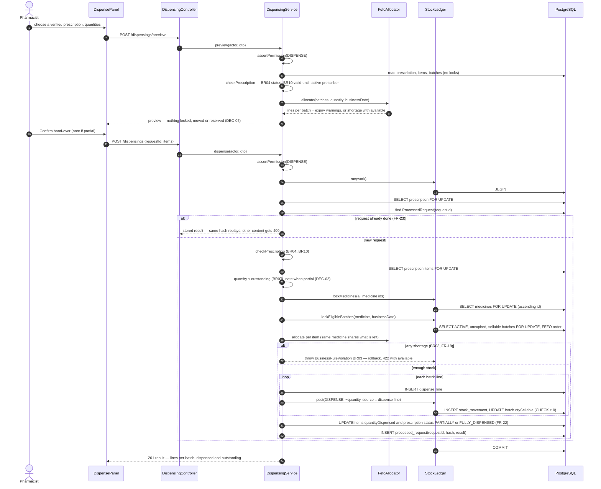
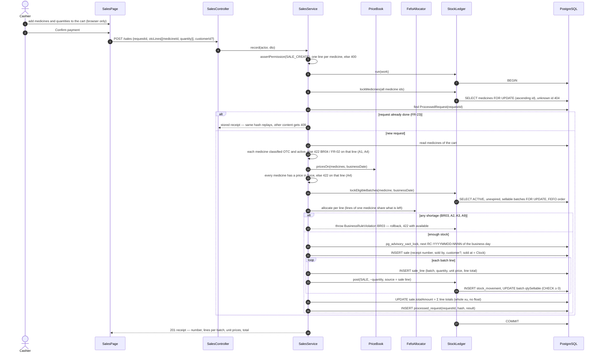
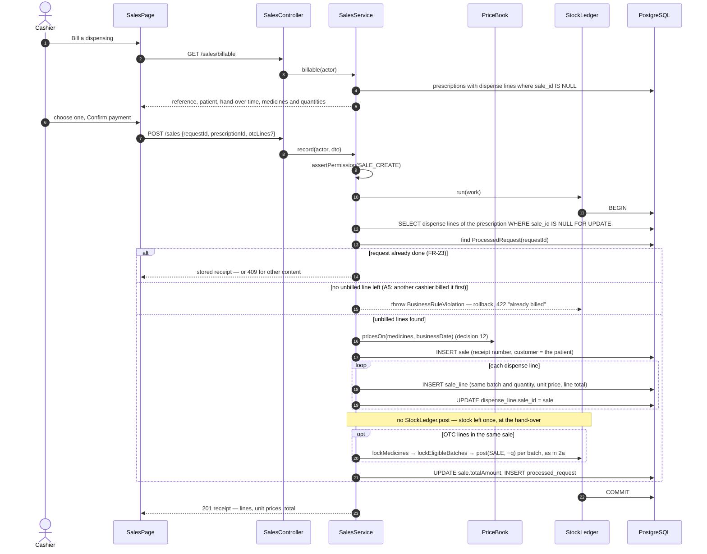
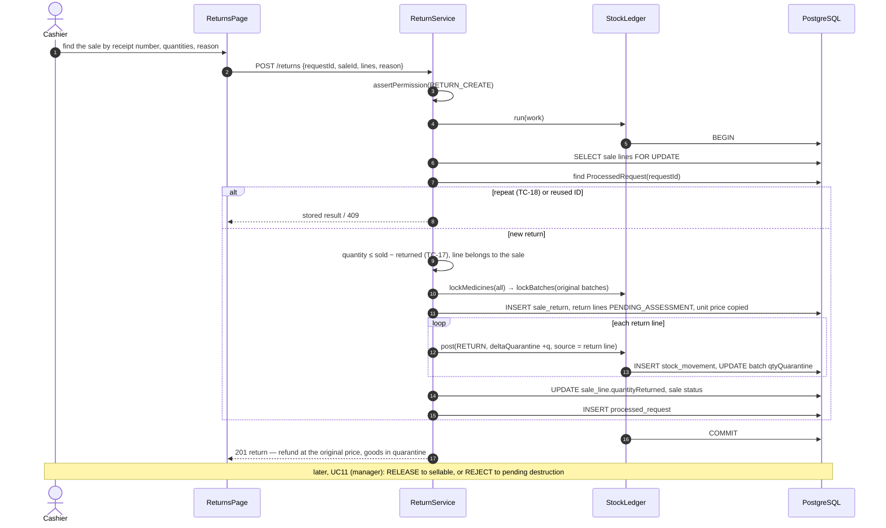
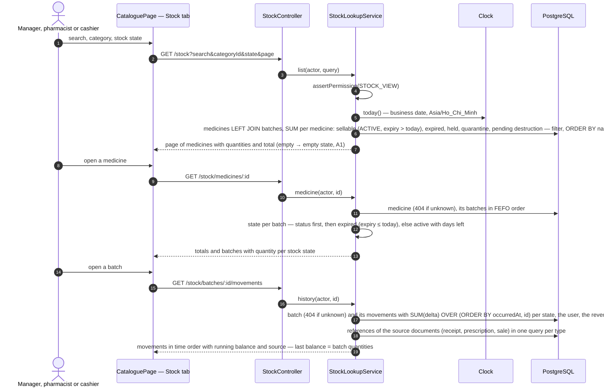
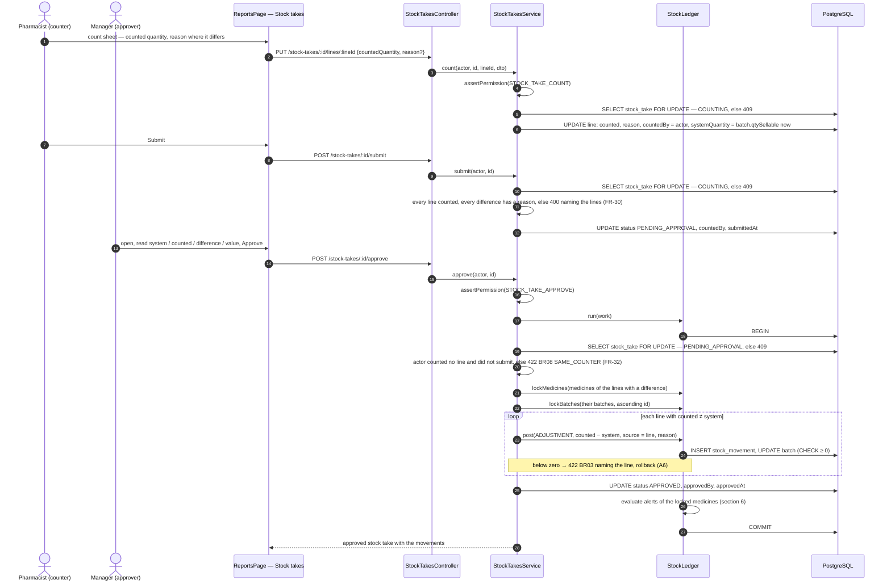
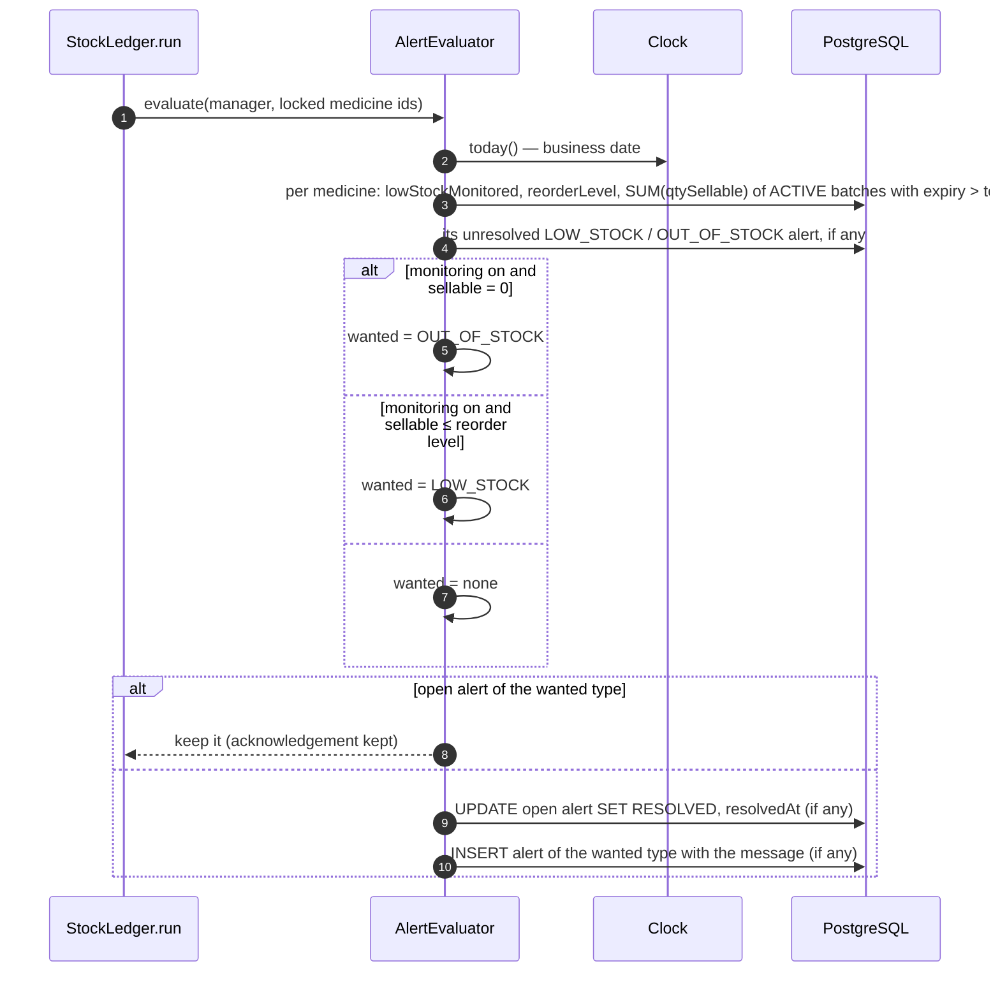
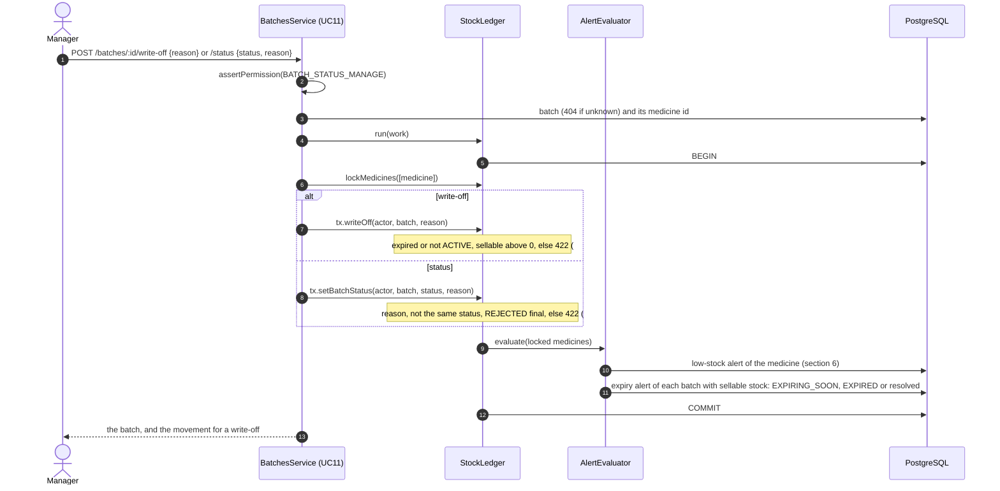
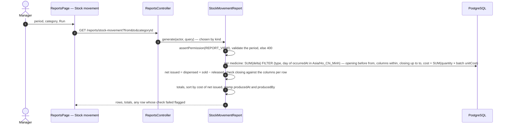

# Sequence diagrams — dispensing, billing, returns, stock lookup

Week 4 task W04-B1 (#31), done late. Three flows where stock and money meet,
drawn so that the lock order and the "stock leaves once" rule (DEC-05) can be
checked before and during review.

| Diagram | Source | State |
|---|---|---|
| 1. Dispense against a prescription (UC06) | The code in #109: `DispensingService`, `FefoAllocator`, `StockLedger` | **As built** |
| 2a. Over-the-counter sale (UC07) | The code: `SalesService`, `FefoAllocator`, `StockLedger`, `PriceBook` | **As built** — matches the design |
| 2b. Bill a dispensing (UC07) | Same | Design gate for #50 (week 6) — update when built |
| 3. Process a return (UC08) | [UC08 specification](../requirements/use-cases/UC08-process-return.md) | Design for #58 — update when built |
| 4. Look up stock and batch history (UC04) | The code: `StockLookupService`, `StockPanel` | **As built** — matches the design |
| 5. Approve a stock take (UC09) | [UC09 specification](../requirements/use-cases/UC09-conduct-stock-take.md) | Design gate for #52 (week 6) — update when built |
| 6. Evaluate low-stock alerts (UC10) | [UC10 specification](../requirements/use-cases/UC10-review-low-stock-alerts.md) | Design gate for #53 (week 6) — update when built |
| 7. Expiry alerts, write-off and batch status (UC11) | [UC11 specification](../requirements/use-cases/UC11-expiry-batch-status-quarantine.md), [ledger commands](../design/stock-ledger.md) | Design gate for #61 (week 7) — update when built |
| 8. Stock movement report (UC12) | [UC12 specification](../requirements/use-cases/UC12-stock-movement-report.md) | Design gate for #62 (week 7) — update when built |

Every diagram that writes (1–3) follows the same transaction pattern: one `StockLedger.run`
(READ COMMITTED, 5-second lock timeout, one retry on deadlock); the document
row that two users could both touch is locked first; then the ledger's own
order — medicines in one call, ascending id, then batches; the request ID is
stored with the result in the same transaction (FR-23). Any error rolls the
whole transaction back, so nothing is half-saved.

## 1. Dispense against a prescription (UC06) — as built

Preview and hand-over are two requests. Only the second moves stock (FR-45).

Why the prescription is locked first: two pharmacists on the same
prescription queue there, so the outstanding quantity one of them reads is
still true when it is written (BR07, TC-54); a repeat of the same request
waits for the first and then finds its stored result.

## 2. Record a sale (UC07) — design

One `POST /sales` records both forms; a sale may hold over-the-counter lines,
a billed prescription, or both. The cart lives in the browser until payment
is confirmed, so adding, changing or cancelling it moves and reserves nothing
(DEC-05, FR-45). Scenario rows (UC07-S01…S16) are in the
[UC07 specification](../requirements/use-cases/UC07-record-sale.md#scenario-table).

Lock order inside the transaction, the same as UC06 so the two cannot
deadlock each other: the billed **prescription's unbilled dispense lines**
first (the document row two cashiers could both touch), then the request ID,
then the ledger's order — medicines in one call, ascending id, then eligible
batches. An over-the-counter sale has no document row, so it locks its
medicines before looking up the request ID: a repeat of the same request
waits there and then finds the stored receipt. The receipt number is drawn
under a transaction-level advisory lock taken after every row lock, so it
cannot form a cycle with them.

### 2a. Over-the-counter sale

Stock leaves at the confirmed payment, by FEFO, only for medicines classified
OTC (DEC-09, BR01, BR02, BR03).

### 2b. Bill a dispensing

The medicines already left the shelf at the hand-over. Billing records the
money only: **no** stock movement (DEC-05, FR-26, TC-52). The schema has no
separate "dispensing" row: a hand-over is the set of `DispenseLine`s of one
prescription, so the cashier bills a prescription, and every dispense line
of it whose `sale_id` is still empty goes on the bill.

Why the dispense lines are locked first: two cashiers billing the same
prescription queue on those rows; the second one, once the first commits,
finds no line with an empty `sale_id` and is refused (A5, TC-52) instead of
billing it twice.

## 3. Process a return (UC08) — design

The returned quantity goes into the **quarantine** of the original batch,
never back to sellable stock (BR11, DEC-04). A manager assesses it later in
UC11.

A return never edits the sale or its movements (BR05): the history of what
was sold stays readable, and the return is a new document with its own
movements. Returning dispensed goods does not restore the prescription's
outstanding quantity (decision 13).

## 4. Look up stock and batch history (UC04) — as built

Read only: no lock, no request ID, nothing written. The two numbers that must
agree with issuing come from the same rule as `StockLedger.lockEligibleBatches`
(ACTIVE, expiry after the business date), and the running balance is computed
from the movements in the query, so it cannot drift from the ledger (BR05).
Scenario rows (UC04-S01…S14) are in the
[UC04 specification](../requirements/use-cases/UC04-look-up-stock.md#scenario-table).

## 5. Approve a stock take (UC09) — design

Counting and posting are apart: the counts are entered and submitted first
(the system quantity of a line is taken when its count is saved, decision
15), and only the approval changes stock, in one ledger transaction, by
someone who counted none of its lines and did not submit it (BR08). Scenario rows UC09-S01…S18 are in the
[UC09 specification](../requirements/use-cases/UC09-conduct-stock-take.md#scenario-table).

## 6. Evaluate low-stock alerts (UC10) — design

The check runs inside `StockLedger.run`, after the command's work and before
the commit, for every medicine the transaction locked: those rows are locked,
so two concurrent commands cannot both raise an alert, and no use case can
forget it. A catalogue change of the reorder level or the switch runs the
same check; so does the first alert request of a new business date. Scenario
rows UC10-S01…S15 are in the
[UC10 specification](../requirements/use-cases/UC10-review-low-stock-alerts.md#scenario-table).

## 7. Expiry alerts, write-off and batch status (UC11) — design

The write-off and the status change are Tiến's ledger commands; their
sequence, with the lock order, is in
[`stock-ledger.md`](../design/stock-ledger.md) § *Week 7*. UC11 adds the
service around them and the expiry alerts, which the same `AlertEvaluator`
as section 6 raises per batch. Scenario rows UC11-S01…S13 are in the
[UC11 specification](../requirements/use-cases/UC11-expiry-batch-status-quarantine.md#scenario-table).

## 8. Stock movement report (UC12) — design

Read only: no lock, nothing written. One SQL statement per report sums the
signed deltas of each movement type per medicine over the period's business
days, so the figures always come from the movements (DEC-06, BR05). Scenario
rows UC12-S01…S13 are in the
[UC12 specification](../requirements/use-cases/UC12-stock-movement-report.md#scenario-table).

