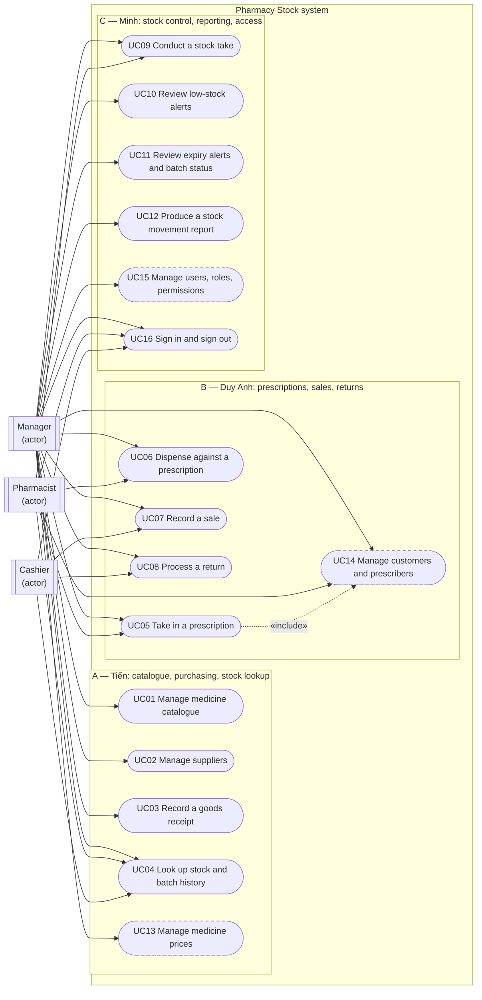

# Use case diagram — whole system

Covers the sixteen use cases of Proposal v1.1 (13 Must, 3 Should) exactly as
listed in [`../requirements/use-cases.md`](../requirements/use-cases.md): no
use case added, removed or renamed, and every actor link follows the
permission table there (Proposal Table 2.4).

Grouped by owner rather than by function, because ownership is how the team
works: each member builds their slice end to end and the review rotation
(A→C→B→A) follows the same split
([`../requirements/use-cases.md`](../requirements/use-cases.md) §Ownership).

The only `«include»` is UC05 → UC14: quick-create of a patient or prescriber
is part of taking in a prescription, while the separate management screens
are UC14 (`use-cases.md`: "quick-create in UC05 is Must").

## How to read

- Three actors on the left; every use case is a stadium node inside the
  system boundary.
- A solid link means the role may perform the use case (permission table in
  `use-cases.md`).
- A dashed border means a Should use case: it starts only after the Must-core
  gate in week 7.
- A dashed, labelled link is an `«include»`: the flow always uses the other
  use case.

## Specification status

Checked with `git ls-tree -r --name-only <ref> docs/requirements/use-cases`
on 13/10/2026 against `origin/main` and the branches named below. "Spec"
means a file in `docs/requirements/use-cases/`; nothing here is guessed.

| UC | Must/Should | Owner | Spec on `main`? | Spec on a branch | Note |
|---|---|---|---|---|---|
| UC01 | Must | A (Tiến) | Yes | — | Built (#97) |
| UC02 | Must | A (Tiến) | Yes | — | Built (#95) |
| UC03 | Must | A (Tiến) | Yes | — | Built (#99) |
| UC04 | Must | A (Tiến) | Yes | — | Specified |
| UC05 | Must | B (Duy Anh) | No | `origin/feature/40-uc05-prescriptions` | In review (#108) |
| UC06 | Must | B (Duy Anh) | No | `origin/feature/40-uc05-prescriptions` | In review (#108) |
| UC07 | Must | B (Duy Anh) | No | `origin/docs/15-uc07-uc08-specs` | In review (#110) |
| UC08 | Must | B (Duy Anh) | No | `origin/docs/15-uc07-uc08-specs` | In review (#110) |
| UC09 | Must | C (Minh) | No | `origin/docs/w02-c3-uc-specs-nfr` | — |
| UC10 | Must | C (Minh) | No | `origin/docs/w02-c3-uc-specs-nfr` | — |
| UC11 | Must | C (Minh) | No | `origin/docs/w02-c3-uc-specs-nfr` | — |
| UC12 | Must | C (Minh) | No | `origin/docs/w02-c3-uc-specs-nfr` | — |
| UC13 | Should | A (Tiến) | Yes | — | Specified |
| UC14 | Should | B (Duy Anh) | No | None found | Quick-create in UC05 is Must |
| UC15 | Should | C (Minh) | No | None found | — |
| UC16 | Must | C (Minh) | No | `origin/docs/w02-c3-uc-specs-nfr` | Dev user switch stands in |
