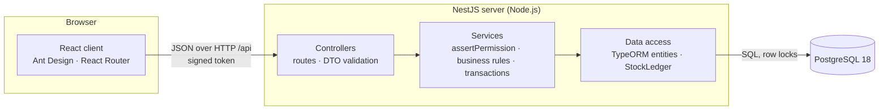

# Ch.3 — Architecture and data (draft)

> **Draft for W08-A3 (#66), written by Tiến.** Final in W09-A1, on `v1.0`:
> the ERD and class diagram are regenerated from the code then (#71), and table
> and figure numbers are set by the editor. Describes `v1.0.1` (26/11/2026).

## 3.1 Architecture

The system has three parts: a React client in the browser, a NestJS server,
and a PostgreSQL 18 database (Figure 3.1). The client never reaches the
database; every read and write goes through the server's JSON API under
`/api`, and every request except sign-in carries a signed token (NFR-05).



*Figure 3.1 — Client, server and database, with the three server layers.*

Inside the server each use-case group is a NestJS module (18 modules in
`src/backend/src/`, for example `catalogue`, `receiving`, `dispensing`,
`sales`, `returns`, `stocktake`, `reports`). A module has the same three
layers everywhere (Table 3.L):

*Table 3.L — The three layers of every server module.*

| Layer | What it does | What it never does |
|---|---|---|
| Controller (`*.controller.ts`) | Maps a route and its validated DTO to one service call | Holds a rule or touches the database |
| Service (`*.service.ts`) | Checks the permission first (`assertPermission`), applies the business rules, runs the transaction | Changes a stock quantity directly |
| Data access (entities, `StockLedger`) | Reads and writes rows; `StockLedger` is the only code that changes stock, and it refuses a change that would break a stock invariant (negative stock, BR03; releasing an expired or controlled batch) | Checks permissions or a use case's own rules; the service decides those |

Rules that need no database are plain classes with unit tests:
`FefoAllocator` (BR01, BR02), `PrescriptionValidator` (BR04, BR07, BR10),
`ExpiryPolicy`, and `ReportGenerator` with one subclass per report (UC10–UC12).

**Errors.** Services throw domain errors (`ValidationFailed` 400,
`PermissionDenied` 403, `NotFound` 404, `Conflict` 409,
`BusinessRuleViolation` 422) instead of HTTP exceptions. One filter turns them
into a single shape, `{ statusCode, code, message, errors[] }`, where each
error names its field. The client places the message under that field
(NFR-04). This keeps HTTP out of the business code and gives the screens one
format to handle.

## 3.2 Data

The schema has 29 entities (`src/backend/src/entities/`). They fall into six
groups (Table 3.1). The ERD follows below.

*Table 3.1 — Entity groups.*

| Group | Entities |
|---|---|
| Catalogue | `Medicine`, `MedicineCategory`, `UnitOfMeasure`, `MedicinePrice` |
| Purchasing | `Supplier`, `GoodsReceipt`, `GoodsReceiptLine` |
| Prescriptions and dispensing | `Customer`, `Prescriber`, `Prescription`, `PrescriptionItem`, `DispenseLine` |
| Sales and returns | `Sale`, `SaleLine`, `SaleReturn`, `ReturnLine` |
| Stock control | `Batch`, `StockMovement`, `StockTake`, `StockTakeLine`, `StockTakeMedicine`, `StockTakeCounter`, `StockAlert`, `DestructionRecord` |
| Access, audit, infrastructure | `User`, `Role`, `Permission`, `AuditLog`, `ProcessedRequest` |

The ERD is generated from the entities by `npm run diagrams` (#71) and drawn
per subsystem, so each part stays readable (the six figures below). The full
column list of every table is in the data dictionary
(`docs/design/data-dictionary.md`).

{{diagram:erd.md@Catalogue|Figure 3.2 — ERD: catalogue}}

{{diagram:erd.md@Purchasing|Figure 3.3 — ERD: purchasing}}

{{diagram:erd.md@Stock and control|Figure 3.4 — ERD: stock and control}}

{{diagram:erd.md@Prescriptions and dispensing|Figure 3.5 — ERD: prescriptions and dispensing}}

{{diagram:erd.md@Sales and returns|Figure 3.6 — ERD: sales and returns}}

{{diagram:erd.md@Access and infrastructure|Figure 3.7 — ERD: access and infrastructure}}

The services and domain classes around the ledger are in Figure 3.8 (class
diagram, written by hand; the entity classes are generated like the ERD,
`docs/diagrams/class-diagram.md`).

{{diagram:class-diagram.md@Stock: the ledger and the rules it applies|Figure 3.8 — Class diagram: the stock ledger and the rules it applies}}

Five decisions shape the data model:

1. **Stock is held on `Batch`, never on `Medicine`.** Expiry belongs to a
   delivered lot, so a single quantity per medicine could not express FEFO or
   the expiry ban. A batch has three quantities: sellable, quarantine and
   pending destruction.
2. **`StockMovement` is append-only.** A trigger in the first migration
   (`trg_stock_movements_append_only`) refuses every `UPDATE` and `DELETE`. A
   correction is a new movement that references the original, at most once
   (BR05).
3. **Expiry is computed, not stored.** A batch can be issued only while its
   expiry date is after the business date in Asia/Ho_Chi_Minh (DEC-01). A
   stored "expired" status would go stale at midnight.
4. **What was prescribed and what was handed over are different rows.**
   `PrescriptionItem` holds the order and `DispenseLine` the hand-over, which
   is what makes partial dispensing and the BR07 check possible.
5. **Money is copied onto the line.** `SaleLine.unitPrice` and
   `GoodsReceiptLine.unitCost` are written when the document is made, and
   prices are a dated history (`MedicinePrice`, BR09). A later price change
   never rewrites a past sale. Money columns are `numeric(12,2)` and are read
   as strings, so no amount passes through floating point.

The schema is built only by migrations (`synchronize` is off). There are
eight: the initial schema with its constraints and triggers, then seven short
hand-written changes, each merged with the feature that needed it. Examples
are the time a movement was written (batch history order), the counters of a
stock take (BR08), destruction records (FR-47), and the last one from the
final code review: a token version per user, one line per batch on a stock
take, and indexes on the foreign keys that reports follow.

## 3.3 The stock ledger

Every change of stock goes through one class, `StockLedger`
(`src/backend/src/stock/stock-ledger.ts`). It does three things in one
transaction:

1. locks the rows;
2. changes the batch quantities;
3. writes one movement per change.

The document (receipt, dispense lines, sale, return) is saved with the same
transaction manager, so the document and its movements commit or roll back
together (FR-09, NFR-07).

The ledger enforces a lock order: every medicine row first, in ascending id,
then the batches. Two commands therefore never wait for each other in a cycle.

### Code excerpt 3.1 — the lock order is enforced, not just documented

`src/backend/src/stock/stock-ledger.ts`, `lockMedicines` (query shortened)

```ts
const ids = [...new Set(medicineIds.map((id) => id.toLowerCase()))]
  .filter((id) => !this.lockedMedicines.has(id))
  .sort();
if (ids.length === 0) return;
if (this.lockedBatches.size > 0) {
  throw new Error('Lock order: lock every medicine before any batch.');
}
if (this.highestMedicineId !== null && ids[0] < this.highestMedicineId) {
  throw new Error(
    'Lock order: medicines must be locked in ascending id; lock them all in one call.',
  );
}
// SELECT … FROM medicines WHERE id IN (…) ORDER BY id FOR NO KEY UPDATE
```

A convention in a design document is easy to break in a new feature. Here a
command that locks a batch before its medicine, or medicines out of order,
fails at once in its own tests instead of deadlocking under load months later.
The medicine row is the lock every stock command for that medicine meets
first, so a sale and a hand-over that race for the last units take turns: the
second one sees the new quantity and is refused (BR03). The race tests repeat
this 20 times per scenario, and two of them hold the lock until both requests
wait (`races.e2e-spec.ts`, RACE-01…05).

**Safety nets below the code:**
- `CHECK` constraints refuse a negative quantity, and a movement whose signs
  do not match its type.
- A trigger refuses edits to movements.
- A unique index allows each movement to be reversed only once.
- In the tests, `findLedgerMismatches()` runs after every e2e test (a global
  `afterEach` in `test/e2e/ledger-check.ts`) and fails the test if any batch's
  cached quantities differ from the sum of its movements (NFR-08).

## 3.4 Data flow of one command

Figure 3.9 follows an over-the-counter sale of three lines:

1. The client sends the lines with a request ID it created for this
   confirmation.
2. The sales service checks `sale.create`.
3. The ledger locks the three medicines in id order, then their eligible
   batches in FEFO order.
4. `FefoAllocator` splits each quantity across batches.
5. The service reads the prices in force on the sale date from `PriceBook`.
6. It writes the sale, its lines and one `SALE` movement per batch line.
7. It stores the result under the request ID (`ProcessedRequest`), so a
   repeated request returns the same receipt instead of selling twice (FR-23).

With 1,000 medicines, 5,000 batches and 10,000 movements in the database,
this takes a median of 66 ms on the server and 258 ms from the click on *Pay*
to the receipt on screen (TC-29, run 83).

{{diagram:sequence-diagrams.md@2a. Over-the-counter sale|Figure 3.9 — Sequence of an over-the-counter sale (UC07)}}
