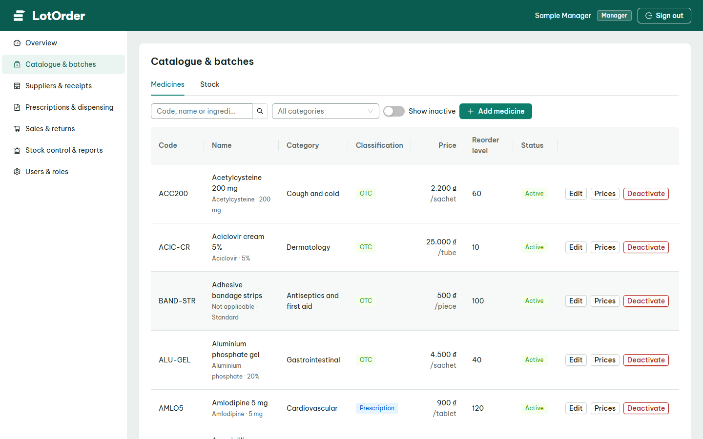
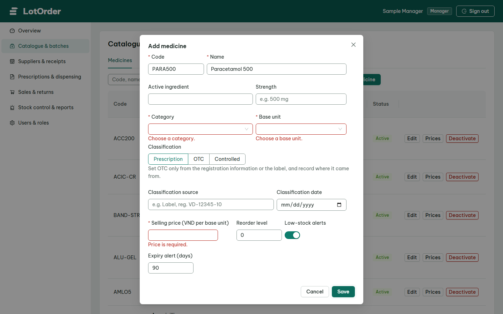
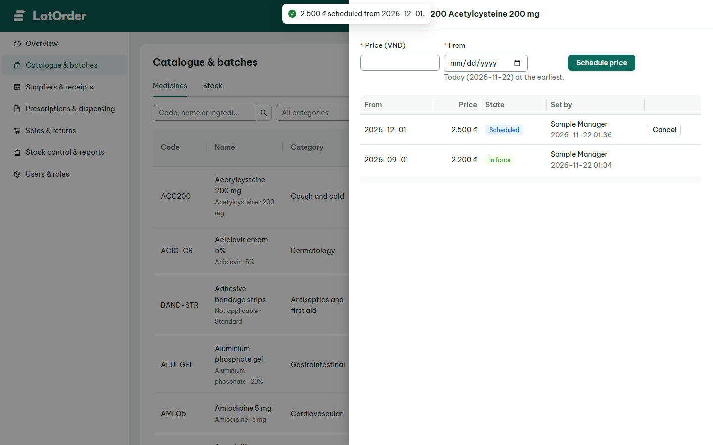
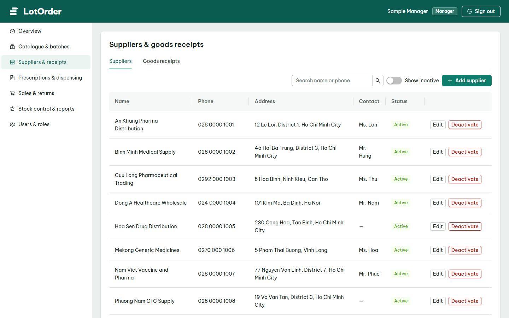
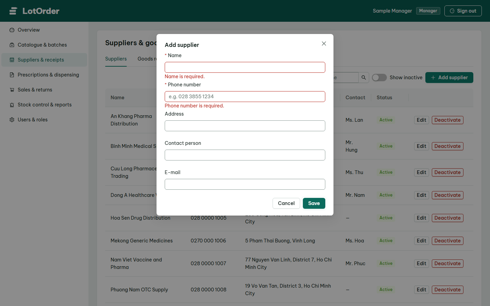
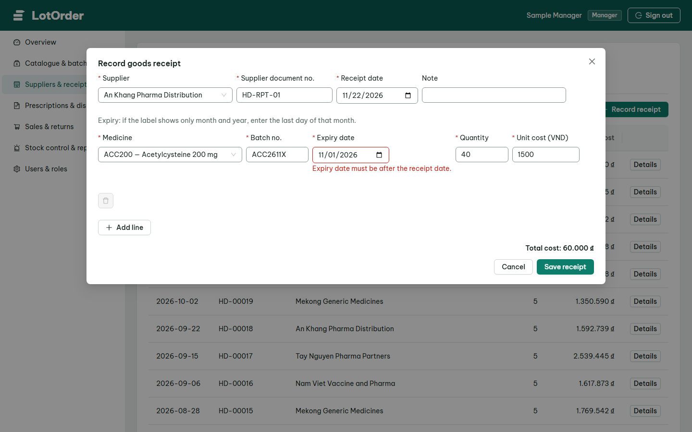
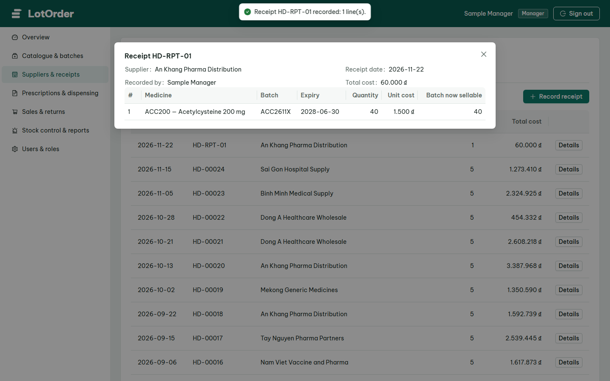
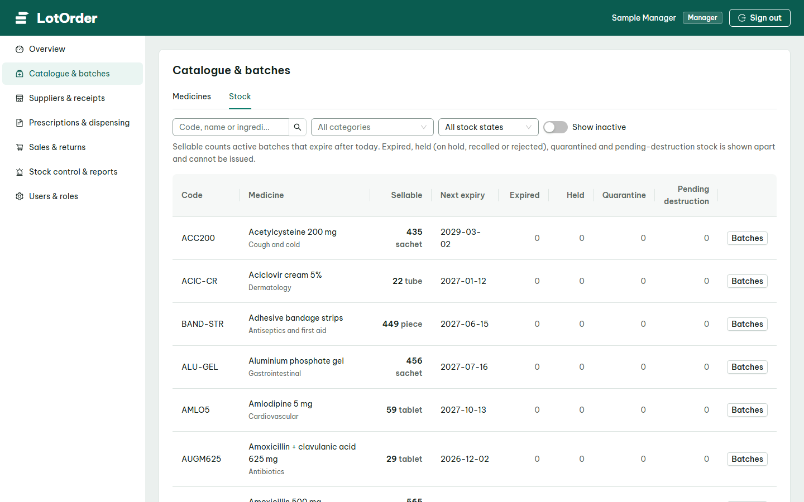
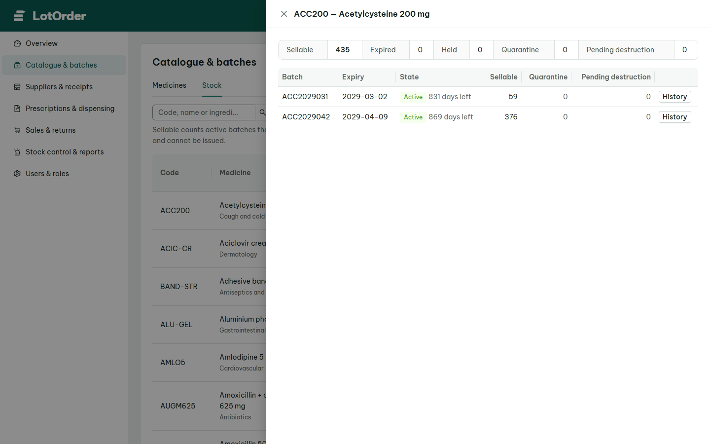
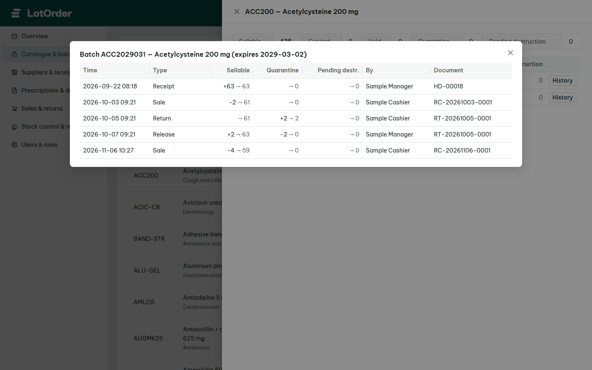

# Ch.3 — Functions of A: catalogue, prices, suppliers, goods receipts and stock lookup

> **W09-A1 (#73), written by Tiến.** Describes `main` at `9063509`
> (22/11/2026). Screenshots were taken on that commit with a database
> migrated and seeded from scratch (`npm run seed`, demo data on), signed in
> as `manager`. Table and figure numbers are set by the editor when the
> chapters are joined.

This part covers the five use cases that bring medicine into the pharmacy and
let everyone see what is on the shelf: the medicine catalogue (UC01), its
selling prices over time (UC13), suppliers (UC02), goods receipts (UC03) and
stock lookup with batch history (UC04). UC01–UC04 are Must; UC13 is a Should
item that was built after the week 7 Must-core gate passed.

They share the layering of the whole system: a thin NestJS controller that
only maps HTTP to a call, a service that checks the permission first
(`assertPermission`) and holds every rule, and TypeORM entities underneath.
The goods receipt is the only command in this part that changes stock, and it
does so only through `StockLedger`, the class that owns every quantity change
(Ch.3, *Architecture and data*).

## Table A.1 — The five use cases at a glance

| Use case | Actor | Input | Output | Stock effect | Rules / FR |
|---|---|---|---|---|---|
| UC01 Manage the medicine catalogue | Manager | Code, name, active ingredient, strength, category, base unit, classification (OTC, prescription, controlled) with source and date, selling price, reorder level, low-stock switch, expiry-alert days | Medicine, active or inactive; its current price | None | FR-01–03, BR10 classification |
| UC13 Manage medicine prices | Manager | Medicine, price (whole VND), first day it applies | Price history: past, in force, scheduled; a scheduled price can be cancelled | None; a sale copies the price in force on the sale date | FR-04, BR09 |
| UC02 Manage suppliers | Manager | Name, phone (both required), contact, e-mail, address | Supplier, active or inactive | None | FR-05 |
| UC03 Record a goods receipt | Manager | Supplier, supplier document number, receipt date, note; per line medicine, batch number, expiry date, quantity, unit cost | Receipt with its lines and total cost; each line's batch created or topped up | One `RECEIPT` movement per line, in one transaction | FR-06–09, BR05 |
| UC04 Look up stock | Any signed-in user | Code, name or ingredient, category, stock state | Per medicine: sellable, expired, held, quarantine, pending destruction; per batch: expiry, state, days left; per batch: every movement | None (read only) | FR-10, FR-11 |

## UC01 — Manage the medicine catalogue

The manager keeps the list of medicines the pharmacy stocks. The *Medicines*
tab of *Catalogue & batches* lists them with code, name, category,
classification, current price, reorder level and status; it searches by code,
name or active ingredient and filters by category (Figure A.1). Inactive
medicines are hidden unless *Show inactive* is ticked.



*Figure A.1 — The medicine catalogue (manager, seeded data).*

*Add medicine* opens one form for the whole record (Figure A.2). The code is
unique; a duplicate is refused with the message under *Code* (FR-01). The
classification defaults to *Prescription*, because a medicine wrongly marked
OTC could be sold without a prescription (BR10); the form asks for the source
of the classification (for example the label or the registration number) and
its date. The selling price is required and must be a positive whole number of
VND (FR-03, #183, #244). Every error is shown under its own field and the
dialog stays open, so nothing is half saved.



*Figure A.2 — Add medicine, saved without a category, base unit or price: each
field says what is missing and nothing is saved.*

*Edit* changes any field; a new code must still be unique, and the base unit
cannot change once the medicine has a batch, because quantities and prices are
stored in it. *Deactivate* never deletes: an
inactive medicine cannot be received, dispensed or sold, but its batches and
history stay visible (FR-02). The check is made by the service that receives,
dispenses or sells, not only by hiding the medicine in a list, so a stale
screen cannot get around it.

**Implementation.** `MedicinesController` → `MedicinesService`
(`src/backend/src/catalogue/`); screen `CataloguePage.tsx`. The low-stock
switch and the expiry-alert window are read by Minh's alerts (UC10, UC11).

**Tests.** 14 e2e tests in `medicines.e2e-spec.ts`. TC-45 and
TC-46 pass (runs 1, 6, 23, 26 in `tests/manual/runs.md`).

## UC13 — Manage medicine prices

Prices are kept as a dated history from the first week (`medicine_prices`, one
row per medicine and first day). UC13 adds the screen that uses it. *Prices*
on a medicine opens a drawer with every price, its first day, its state
(*Past*, *In force*, *Scheduled*) and who set it (Figure A.3). The manager
schedules a new price from a future date; the price in force does not change
until that day. A scheduled price can be cancelled before it starts; a price
already in force cannot, since sales may have used it. The first day can be
today at the earliest, and two prices cannot start on the same day.



*Figure A.3 — ACC200: 2.500 ₫ scheduled from 2026-12-01; 2.200 ₫ stays in
force until then.*

A sale values each line at the price in force **on the sale date** and copies
it onto the sale line (BR09). Changing or scheduling a price therefore never
alters a past receipt, and a return refunds the price that was paid.

### Code excerpt A.1 — the price in force on a date

```ts
// src/backend/src/catalogue/price-book.ts — PriceBook.pricesOn
const rows: { medicine_id: string; unitPrice: string }[] =
  await manager.query(
    `SELECT DISTINCT ON (medicine_id) medicine_id, "unitPrice"
       FROM medicine_prices
      WHERE medicine_id = ANY($1) AND "effectiveFrom" <= $2
      ORDER BY medicine_id, "effectiveFrom" DESC`,
    [medicineIds, date],
  );
return new Map(rows.map((r) => [r.medicine_id, r.unitPrice]));
```

The rule "the price in force is the latest one that started on or before the
date" is one query, and every caller (the sale, the cart preview, the
catalogue column) goes through it. That is why a scheduled price needed no
change to the sales code: it is simply a row whose `effectiveFrom` has not been
reached yet. `DISTINCT ON` returns one row per medicine, so a cart with many
lines is priced in one round trip.

**Implementation.** `PricesController` → `PricesService`, `PriceBook`
(`src/backend/src/catalogue/`); screen `PricesDrawer.tsx` (#259).

**Tests.** 10 e2e tests in `prices.e2e-spec.ts` and the `BR09-01…06` tests in
`price-book.e2e-spec.ts`. TC-40 passed with the sale on the day the scheduled
price started (run 92) and TC-41 passed (run 82).

## UC02 — Manage suppliers

The *Suppliers* tab of *Suppliers & receipts* lists suppliers with name,
phone, contact, address and status, searchable by name or phone (Figure A.4).
Name and phone number are required (FR-05, Figure A.5); the phone may hold
8–20 characters of digits, spaces, dots, dashes and a leading `+`. As for medicines, a supplier is deactivated rather
than deleted: its past receipts keep pointing at it, and a receipt from an
inactive supplier is refused.



*Figure A.4 — The supplier list (seeded data).*



*Figure A.5 — Add supplier, saved empty: name and phone are required.*

**Implementation.** `SuppliersController` → `SuppliersService`
(`src/backend/src/suppliers/`); screen `SuppliersPage.tsx`. UC02 was the
first slice of the project (#95) and set the pattern the other modules copy
(`docs/design/how-to-add-a-module.md`).

**Tests.** 12 e2e tests in `suppliers.e2e-spec.ts` (UC02-01…12); TC-46 passes.

## UC03 — Record a goods receipt

A delivery arrives with the supplier's invoice. The manager opens *Record
goods receipt* on the *Goods receipts* tab and enters the supplier, the invoice
number, the receipt date and one line per batch: medicine, batch number,
expiry date, quantity and unit cost. The total is computed while typing, each
line shows its own total, and a cost typed as `15.000` is read as fifteen
thousand like every other amount on screen. When
the label shows only a month and year, the form says to enter the last day of
that month, so a batch is never treated as valid longer than it is.

The service refuses, field by field (FR-07, FR-08):

- a quantity that is not a positive whole number, or a negative unit cost;
- an expiry date on or before the receipt date (Figure A.6);
- an inactive medicine or supplier;
- an invoice number already recorded for the same supplier;
- an existing batch number of the same medicine with a different expiry date,
  or a batch that is no longer active (decision 17).



*Figure A.6 — Expiry 01/11/2026 on a receipt dated 22/11/2026: "Expiry date
must be after the receipt date."; nothing is saved.*

Because a saved receipt is never edited, *Review and save* first shows every
line read back (medicine, batch, expiry, quantity with its unit, unit cost
and line total) with the total, and saves only on confirmation.

When everything is valid, the receipt, its lines, any new batch and one
`RECEIPT` movement per line are written **in one transaction** (FR-06, FR-09):
if any line fails, nothing of the receipt is saved. The new stock is sellable
at once (unless a backdated receipt brings a batch whose expiry has already
passed by today; it is then shown as expired), and the receipt opens to show what was recorded (Figure A.7).



*Figure A.7 — Receipt HD-RPT-01 saved: batch ACC2611X, 40 units, now sellable.*

Two details matter for correctness. The supplier is read with a shared lock and
the medicines are locked before the batches, in the same order as dispensing
and sales, so a receipt cannot deadlock with them or save against a supplier
deactivated at the same moment. And the batch's *received at* is the receipt
date in Vietnam time, not the time of typing, because FEFO breaks ties between
batches with the same expiry by the earlier receipt (DEC-07).

**Reversing a wrong receipt.** A receipt entered by mistake is undone with
*Reverse goods receipt* and a reason: every line's `RECEIPT` movement gets its
exact opposite in one transaction (BR05, `StockLedger.reverseAll`, which locks
all medicines and then all batches). It is refused once any of the stock has
been sold, dispensed or moved (BR03), and allowed only once. The receipt stays
in the list marked *Reversed*, the batch history shows both movements, and
the audit log records who reversed it and why.

**Implementation.** `GoodsReceiptsController` → `GoodsReceiptsService.create`
and `.reverse` (`src/backend/src/receiving/`), which run inside
`StockLedger.run`; screen `GoodsReceiptsPanel.tsx`.

**Tests.** 19 e2e tests in `goods-receipts.e2e-spec.ts` (UC03-01…19). TC-01
(runs 2, 24, 67), TC-02 (failed in runs 4–5, bug #125; passed after the fix in runs 14 and 25), TC-03 (runs 3, 68) and TC-25
(run 71, a failed line saves nothing) pass.

## UC04 — Look up stock and batch history

Every role holds `stock.view` by default, so anyone at the counter can answer
"how many can we sell, and from which batch?". The
*Stock* tab lists each medicine with its sellable quantity and the next expiry
(Figure A.8). Sellable leaves out every unit that may not be issued: expired,
held, recalled, rejected, in quarantine or pending destruction (FR-10). The
filter *Stock state* finds, for example, every medicine that holds expired
stock.



*Figure A.8 — Stock: sellable quantity and next expiry per medicine.*

*Batches* opens one medicine: the totals per stock state, then each batch with
its expiry, state, days left and quantity in each state (Figure A.9).
*History* shows every movement of a batch in time order, with type, signed
quantity, resulting balance per state, user, time and source document
(Figure A.10, FR-11). A sale shows its receipt number (`RC-…`), a return its
slip (`RT-…`), a stock-take adjustment its stock take (`ST-…`), so any number
on screen can be traced to the paper behind it (#209).



*Figure A.9 — ACC200: two active batches, 435 sellable.*



*Figure A.10 — Batch ACC2029031: received 63, sold 2, returned 2 into
quarantine, released back to sellable, sold 4.*

The history is read straight from the stock ledger, which is never edited: a
mistake is corrected by a new opposite movement (BR05). The balance after every
row therefore always adds up to the quantity on the batch, and TC-48 checks
exactly that.

**Implementation.** `StockLookupController` → `StockLookupService`
(`src/backend/src/lookup/`); screen `StockPanel.tsx`.

**Tests.** 15 e2e tests in `stock-lookup.e2e-spec.ts` (UC04-01…15). TC-24
(run 27) and TC-48 (runs 34, 73) pass.

## What was not built in this part

- **Pack-unit conversion (FR-42, BR06, Could).** Quantities are entered in the
  base unit. It was the first item cut in the Proposal's MoSCoW plan.
- **Purchase orders, supplier payments and barcode scanning** were out of scope
  from the Proposal (§1.3) and stay out.
