# Ch.3 — Problem, functional analysis, technologies, other deliverables

> **Written by Tiến (#73, #82).** Sections 3.1, 3.2.1, 3.3.1 and 3.3.4 of the
> template; the report build puts each one in its place among the other Ch.3
> files. Describes `main` at `9063509` (22/11/2026).

## 3.1 Problem Description and System Objectives

### Problem statement

A small pharmacy keeps stock per medicine, not per batch, in a notebook or a
spreadsheet. Nobody can tell which box expires first, so expired stock is
found at the counter. The picking order depends on memory. Figures drift from
the shelf, and a correction overwrites the old number. A prescription is
checked by hand, and returned goods go back on the shelf unchecked (Ch.2
§2.2). The problem is not missing data entry. It is that nothing **enforces**
the rules a pharmacy must follow.

### Objectives of the proposed solution

A web application where the rules are enforced by the system, in the service
layer, for every user and every request:

- stock is held per batch, and every change is one movement in an append-only
  ledger, so every figure can be explained;
- dispensing and sales pick batches by FEFO and never issue an expired, held,
  recalled or quarantined unit;
- stock never goes negative, even when two users compete for the last units;
- a prescription-only medicine is issued only against a verified, valid
  prescription, never above the quantity prescribed;
- each of three roles can do exactly what its permissions allow.

The measurable objectives SO1–SO8 and their results are in Ch.1 §1.2.

### Scope of the system

One pharmacy with one storage location; three roles; the sixteen use cases
of Table 2.1, all built. The exclusions of Ch.1 §1.3 hold: no link to
national systems or e-invoices, no payments, no clinical checks, simulated
data only, run locally.

## 3.2.1 Functional Analysis

### Functional decomposition diagram

The system is decomposed into seven modules. Each is owned by one member from
screen to test, and each maps to NestJS modules on the server (Figure 3.1).

```mermaid
flowchart TB
    SYS["LotOrder — pharmacy stock and prescription dispensing"]
    SYS --> M1["M1 Catalogue and pricing<br/>UC01, UC13 · Tiến"]
    SYS --> M2["M2 Purchasing<br/>UC02, UC03 · Tiến"]
    SYS --> M3["M3 Stock lookup and ledger<br/>UC04 · Tiến"]
    SYS --> M4["M4 Prescriptions and dispensing<br/>UC05, UC06, UC14 · Duy Anh"]
    SYS --> M5["M5 Sales and returns<br/>UC07, UC08 · Duy Anh"]
    SYS --> M6["M6 Stock control and reporting<br/>UC09–UC12 · Minh"]
    SYS --> M7["M7 Access control<br/>UC15, UC16 · Minh"]
    M1 --> M1a["Medicines, classification"] & M1b["Prices by effective date"]
    M2 --> M2a["Suppliers"] & M2b["Goods receipts → batches"]
    M3 --> M3a["Stock by state"] & M3b["Batch history"]
    M4 --> M4a["Prescriptions, verification"] & M4b["FEFO dispensing"] & M4c["Customers, prescribers"]
    M5 --> M5a["Over-the-counter sale, billing"] & M5b["Returns into quarantine"]
    M6 --> M6a["Stock take"] & M6b["Alerts, expiry, write-off"] & M6c["Quarantine, destruction"] & M6d["Stock movement report"]
    M7 --> M7a["Sign in/out"] & M7b["Users, roles, audit log"]
```

*Figure 3.1 — Functional decomposition into seven modules and their owners.*

### Use case diagram

The use case diagram (Figure 3.2) shows the three actors and the sixteen use
cases. Every actor link follows the permission table of Ch.2 (Table 2.4).

{{diagram:use-case-diagram.md#1|Figure 3.2 — Use case diagram}}

## 3.3.1 Technologies and Tools Used

*Table 3.1 — Technologies*

| Area | Choice | Why |
|---|---|---|
| Programming language | TypeScript 6, on both client and server | One typed language end to end; the compiler checks the DTOs and entities shared in shape between the two |
| Server framework | NestJS 12 on Node.js 24 | Modules, dependency injection and decorators give the layered structure the course asks for without hand-made wiring |
| Persistence | TypeORM 1.1, with migrations only (`synchronize: false`) | Entities as classes; transactions and row locks for the stock ledger; a schema change is a reviewed migration |
| Database | PostgreSQL 18 (Docker Compose) | Transactions, row-level locks (`FOR NO KEY UPDATE`, `FOR SHARE`) and partial unique indexes, which the stock rules rely on |
| Client | React 19, Ant Design 6, React Router 7, Vite 8 | A component library with accessible tables, forms and modals, so effort went into the rules, not widgets |
| Authentication | JWT (`@nestjs/jwt`), bcrypt password hashes | Stateless sessions with an 8-hour expiry (FR-38); passwords never stored in clear (NFR-05) |
| Testing | Vitest 4 (unit and end-to-end against a real test database), Playwright for scripted UI runs | Business rules tested without a database; end-to-end tests go through the real HTTP routes |
| Quality | oxlint, GitHub Actions CI (build, lint, all tests) required before merge | `main` always builds (NFR-11) |
| Tools | Git and GitHub (issues, pull requests, projects), VS Code, Docker Desktop or Podman, mermaid for diagrams | — |

Every runtime library, with its exact version, licence and purpose, is listed
in the references and libraries appendix (`docs/report/references.md`).

## 3.3.4 Other Deliverables

### APIs

A REST API under `/api`, 77 routes behind sign-in plus `POST /api/auth/login`.
Every route and the permission it needs is in
`docs/design/access-control.md`, and the automated matrix TC-53 checks every
route for every role. Errors have one shape,
`{ statusCode, code, message, errors[] }` (`docs/design/error-handling.md`).

### Documentation

- `README.md` and the run guide `docs/run-guide.md`: install, configure, seed,
  run, test, back up and restore.
- Requirements: functional and non-functional requirements, business rules,
  sixteen use-case specifications, business decisions with the pharmacist's
  review, and the traceability matrix (`docs/requirements/`).
- Design: domain model, data dictionary, stock ledger, error handling, access
  control, UI design and brand guide (`docs/design/`); use case, class,
  sequence and entity-relationship diagrams (`docs/diagrams/`), the class
  diagram, ERD and data dictionary generated from the code (`npm run
  diagrams`).
- Tests: 65 manual test cases and the log of every run with its evidence
  (`tests/manual/`).
- Process: the ten weekly plans, weekly progress reports, meeting journal and
  the GitHub project board [2].

Everything above is in the team repository [1].

### Deployment files

`docker-compose.yml` (PostgreSQL 18), `.env.example` for server and client,
the migrations in `src/backend/src/migrations/`, the seed (`npm run seed`:
reference data and a two-month simulated history), and the CI workflow in
`.github/workflows/`. Releases are tagged `v0.1`, `v0.2` and `v1.0`.

### Supporting materials

As-built and design wireframes (`docs/diagrams/wireframes/`), the LotOrder
identity (`docs/assets/`), the performance and backup scripts (`npm run
perf:load`, `perf:measure`, `balances`), and the progress dashboard on GitHub
Pages.

## References (this chapter)

[1] NeitLN, "261_72ITSE41704_2474802010391_PharmacyStock," GitHub repository.
[Online]. Available:
https://github.com/NeitLN/261_72ITSE41704_2474802010391_PharmacyStock

[2] NeitLN, "Pharmacy stock — project board," GitHub Projects. [Online].
Available: https://github.com/users/NeitLN/projects/1
