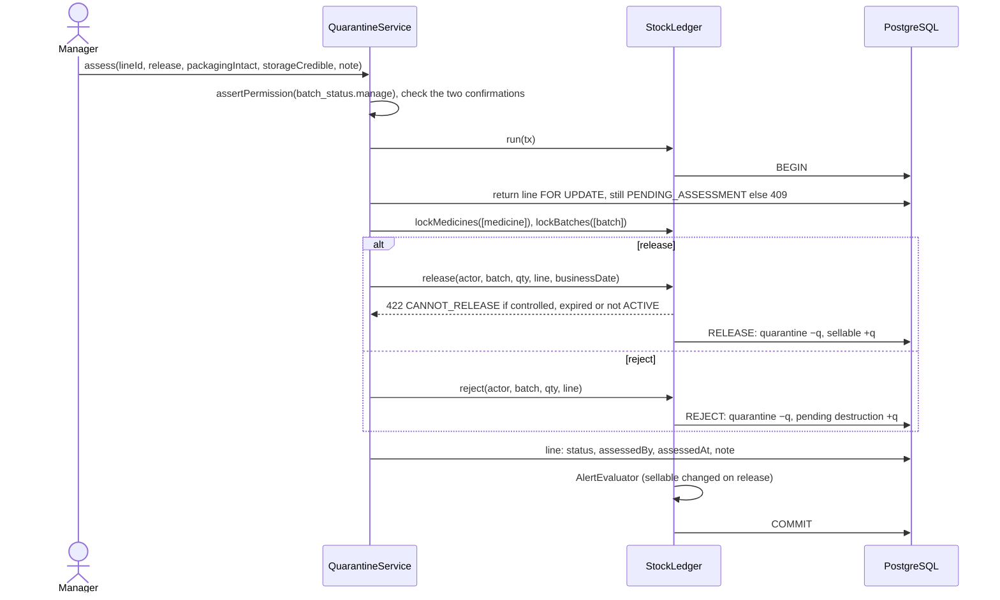
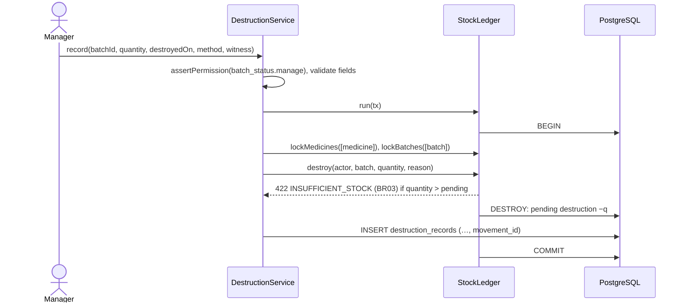

# UC11 — Review expiry alerts, batch status and quarantined stock

| | |
|---|---|
| **Owner** | Võ Hoàng Minh (C) |
| **Priority** | Must (assessing returns and recording destruction are Should) |
| **Primary actor** | Manager |
| **Status** | Built (#61): the Must part. FR-46 and FR-47 (Should): designed for #105 below (interface, sequences, S14–S22). Tests UC11-01…13 in `expiry.e2e-spec.ts` |
| **Related rules** | BR02, BR03 (via the ledger), BR05, BR11 |
| **Requirements** | FR-35, FR-36, FR-48, FR-46 *(S)*, FR-47 *(S)*, FR-39 |
| **Decisions** | DEC-01 (expiry boundary), DEC-04 (quarantine, pending destruction, destroyed), DEC-07 (batch status), decision 16 (one unresolved expiry alert per batch) |

## Goal

The manager sees which batches expire soon, so they can be used first or
returned to the supplier in time, and which have expired, so they are taken
off sale with a record. The manager can also take a batch out of circulation
(on hold, recalled, rejected), and decide what happens to goods customers
returned. Nothing is recorded as destroyed until it actually is. Sources: S1
("periodic inspection for expiration dates and removal of outdated stock";
recalled products "stored separately") and S2 items 9.2–9.4 in
[`../sources.md`](../sources.md).

## Preconditions

- The manager holds `alert.manage` (expiry list and alerts) and
  `batch_status.manage` (write-off, batch status, assessment, destruction).

## Postconditions

- **Write-off:** one `WRITE_OFF` movement moves the batch's whole sellable
  quantity to pending destruction, with the reason and the user; the batch's
  expiry alert is resolved. The stock is **not** recorded as destroyed.
- **Batch status change:** the batch has its new status, reason, user and
  time; no movement is posted; stock-level alerts for the medicine are
  re-evaluated (FR-33).
- **Assessment (S):** a `RELEASE` or `REJECT` movement for the returned
  quantity, and the return line marked RELEASED or REJECTED with user, time
  and note.
- **Destruction (S):** a `DESTROY` movement removes the quantity from pending
  destruction.
- **Failure:** nothing changes.

## Definitions (DEC-01, decision 10)

- A batch is **expired** when its expiry date is on or before the business
  date (Asia/Ho_Chi_Minh). Expiry is computed, not a batch status.
- A batch is **expiring soon** when business date < expiry date ≤ business
  date + the medicine's `expiryAlertDays` (default 90).
- Only batches with sellable stock appear in the lists and raise alerts.

At the start of each business day the system raises at most one unresolved
EXPIRING_SOON or EXPIRED alert per batch (decision 16): when a batch passes
its expiry date the EXPIRING_SOON alert is resolved and an EXPIRED one raised.
BR02 does not depend on this run; issuing compares the expiry date with the
business date directly.

## Main flow — expiry and write-off

1. The manager opens *Stock control → Expiry*.
2. The system shows *Expired* and then *Expiring soon*, by expiry date: medicine,
   batch number, expiry date, days left or days since expiry, sellable
   quantity, value at unit cost, batch status (FR-35).
3. The manager selects an expired batch and chooses *Write off*.
4. The system shows the quantity that will move to pending destruction and
   asks for a reason.
5. The manager confirms.
6. In one `StockLedger` transaction the system locks the medicine and the
   batch, posts one `WRITE_OFF` movement of the whole sellable quantity
   (sellable → pending destruction), and resolves the batch's expiry alert
   (FR-36).
7. The system shows the batch with sellable 0 and the quantity pending
   destruction.

## Alternative and error flows

| ID | At step | Condition | What the system does | Ends in |
|---|---|---|---|---|
| A1 | 2 | Nothing expired or expiring | "No batch with stock expires within its alert window" | End |
| A2 | 2 | The manager acknowledges an expiry alert instead | ACKNOWLEDGED with user and time | Step 2 |
| A3 | 3 | The batch is not expired | *Write off* is not offered; a direct API call is refused: "Only an expired batch can be written off" | Step 2 |
| A4 | 4 | The reason is empty | Error on the reason field | Step 4 |
| A5 | 6 | The sellable quantity is already 0 (issued since the page loaded) | Refused: "Nothing left to write off"; the alert is resolved | Step 2 |
| A6 | 6 | The database fails part-way | Everything rolls back | Failure |
| A7 | any | The user lacks the permission (Pharmacist, Cashier) | 403 from the service (TC-28) | Failure |

## Sub-flow — change a batch's status (FR-48, DEC-07)

1. From the expiry list or the batch view (UC04), the manager chooses
   *Change status* on a batch.
2. The system offers ACTIVE, ON_HOLD, RECALLED or REJECTED and asks for a
   reason.
3. The manager chooses a status, gives the reason and confirms.
4. The system records status, reason, user and time on the batch and
   re-evaluates stock-level alerts for the medicine. A batch that is not
   ACTIVE is left out of FEFO, sales and the sellable quantity from that
   moment (TC-60).

A reason is required for every change, including back to ACTIVE.

## Sub-flow — assess a quarantined return (FR-46, Should)

1. The manager opens *Stock control → Quarantine*.
2. The system lists return lines in PENDING_ASSESSMENT: medicine, batch,
   expiry, quantity, return date and reason, and whether the medicine is
   controlled.
3. The manager chooses *Release* or *Reject* with a note.
4. *Release* is allowed only if the medicine is not controlled, the batch is
   not expired, and the manager confirms the packaging is intact and the
   storage credible; then a `RELEASE` movement moves the quantity from
   quarantine to sellable stock. *Reject* posts a `REJECT` movement from
   quarantine to pending destruction. Either way the return line records the
   outcome, user, time and note, in one transaction.

A release that fails a condition is refused with the reason (BR11); the item
stays in quarantine.

## Sub-flow — record destruction (FR-47, Should)

1. The manager opens the stock pending destruction, selects a batch and
   enters the quantity destroyed, the date, the method (e.g. returned to the
   supplier, destroyed by a licensed contractor) and the witness.
2. The system posts a `DESTROY` movement for that quantity. Until then the
   stock is shown as pending destruction, never as destroyed.

## Functional requirements

| ID | Requirement (short form) | Test cases |
|---|---|---|
| FR-35 | List batches with stock expiring within the alert window and already expired, with quantity and days remaining. | TC-22 |
| FR-36 | Write off an expired batch with a reason: a WRITE_OFF movement to pending destruction, not recorded as destroyed. | TC-56 |
| FR-48 | Set a batch ACTIVE, ON_HOLD, RECALLED or REJECTED with a reason; a non-ACTIVE batch is excluded from FEFO, sales and the sellable quantity. | TC-60 |
| FR-46 *(S)* | Assess a quarantined return: release only if not controlled, not expired, packaging intact and storage credible, or reject to pending destruction, with user and time. | TC-61 |
| FR-47 *(S)* | Record destruction (date, method, witness) as a DESTROY movement; until then shown as pending destruction. | TC-61 |
| FR-39 | Permission checked in the service on every request. | TC-28, TC-53 |

TC-22 checks the window boundary: a batch expiring on the business date, the
day after, the last day of the window and the day after it, and one checked
at 23:30 and 00:30 Asia/Ho_Chi_Minh.

## Decisions for the build

The open questions of the spec, settled for #61 as assumptions; each can be
changed in one place. The stock commands are Tiến's ledger commands from #55
([`stock-ledger.md`](../../design/stock-ledger.md) § *Week 7*); UC11 only
checks the permission, locks the medicine and calls them.

| Question | Taken for the build | Why |
|---|---|---|
| Scope in week 7 | The Must part: the expiry list (FR-35), write-off (FR-36), batch status (FR-48) and expiry alerts. Assessing returns (FR-46) and recording destruction (FR-47) are Should and move to week 8 with #105, after the Must-core gate. | Plan week 7 §8; #105 |
| What may be written off | The whole sellable quantity of a batch that is **expired or not ACTIVE** (on hold, recalled, rejected), as `writeOff` in #55 enforces: a recalled batch has to leave the shelf too. An active, unexpired batch is refused (`BATCH_STILL_SELLABLE`); damage found on the shelf goes through a stock take (UC09). | #55 contract; open question 2 |
| Status changes | Through `setBatchStatus`: a reason is always required, REJECTED is final, the same status again is refused. The medicine is locked first, so the UC10 hook re-evaluates its low-stock alert in the same transaction (FR-33). | #55; DEC-07 |
| Expiry alerts | Per batch with sellable stock, whatever its status: EXPIRING_SOON when business date < expiry ≤ business date + `expiryAlertDays`, EXPIRED when expiry ≤ business date; at most one unresolved per batch (decision 16, partial unique index). Evaluated by the same `AlertEvaluator` as UC10: for the batches of every medicine a ledger command locked, and for all batches on API start and on the first alert request of a new business date. A write-off empties the batch, so its alert resolves in the same transaction. | Decision 16; UC10 decisions |
| Where expiry alerts are listed | The UC10 alert list (`GET /alerts`) gains the types `expiring_soon` and `expired`; acknowledging works the same way. | One alert list, FR-34 |
| The expiry list | An `ExpiryReport` (see UC12, *ReportGenerator*): expired first, then expiring soon, by expiry date; medicine, batch, expiry, days left (negative when expired), sellable quantity, value at unit cost, batch status. | FR-35, decision D14 |
| Permissions | Expiry list and alerts: `alert.manage`. Write-off and status: `batch_status.manage`. Both are the manager's (Table 2.4). | Preconditions |
| Destruction record (FR-47) | Settled for #105: a `destruction_records` table: batch, quantity, date destroyed, method (`supplier_return`, `licensed_contractor`, `other` with a note), witness, who recorded it and when, and the `DESTROY` movement it posted (one to one). The ledger's `destroy` command is unchanged; the record is the source document DEC-04 asks for, so *destroyed* always has a date, a method and a witness. | DEC-04; open question 1 |
| Quarantined goods of an expired batch | Settled for #105: listed with *Release* disabled and the reason (expired, controlled, or batch not ACTIVE), so they can only be rejected. The ledger's `release` refuses them anyway (`CANNOT_RELEASE`). | DEC-04; open question 3 |

## Interface (for #61)

| Route | Permission | Body / response |
|---|---|---|
| `GET /api/reports/expiry?categoryId=` | `alert.manage` | `ExpiryReport`: `{ kind: 'expiry', producedAt, producedBy, rows: [{ batch: { id, batchNumber, expiryDate, status }, medicine: { id, code, name }, state: 'expired' \| 'expiring_soon', daysLeft, sellable, value }] }` |
| `POST /api/batches/:id/write-off` | `batch_status.manage` | `{ reason }` → `{ batch: { id, batchNumber, qtySellable, qtyPendingDestruction }, movement: { id, deltaSellable, deltaPendingDestruction } }` |
| `POST /api/batches/:id/status` | `batch_status.manage` | `{ status: 'active' \| 'on_hold' \| 'recalled' \| 'rejected', reason }` → the batch with `status`, `statusReason`, `statusChangedBy`, `statusChangedAt` |
| `GET /api/alerts?type=expiring_soon\|expired` | `alert.manage` | As UC10, each alert with its batch |

Errors use the existing format: 400 on `reason` or `status`, 403, 404 for an
unknown batch in the path, 422 with the rule (`BATCH_STILL_SELLABLE`,
`NOTHING_TO_WRITE_OFF`, `BATCH_STATUS_UNCHANGED`, `BATCH_REJECTED_FINAL`).

On screen: *Stock control & reports* gets an **Expiry** tab (the report, with
*Write off* on a row that may be written off and *Change status* on every row);
the expiry alerts show in the alerts tab. Wireframes: Tiến, #154.

## Interface (week 8, #105: FR-46, FR-47)

| Route | Permission | Body / response |
|---|---|---|
| `GET /api/quarantine` | `batch_status.manage` | Return lines in PENDING_ASSESSMENT, oldest first: `[{ returnLineId, saleReturn: { id, referenceNumber, returnedAt, reason }, medicine: { id, code, name, classification }, batch: { id, batchNumber, expiryDate, status }, quantity, releaseBlockedBy: null \| 'controlled' \| 'expired' \| 'batch_not_active' }]` |
| `POST /api/quarantine/:id/assess` | `batch_status.manage` | `{ outcome: 'release' \| 'reject', packagingIntact, storageCredible, note }` → the line with `assessmentStatus`, `assessedBy`, `assessedAt`, `assessmentNote`, and the movement |
| `GET /api/batches/pending-destruction` | `batch_status.manage` | Batches with stock pending destruction: medicine, batch, expiry, status, `qtyPendingDestruction` |
| `POST /api/batches/:id/destructions` | `batch_status.manage` | `{ quantity, destroyedOn, method, methodNote?, witness, note? }` → 201 the record with its `DESTROY` movement |
| `GET /api/batches/:id/destructions` | `batch_status.manage` | The batch's destruction records, newest first |

Rules and errors (existing format):
- **Assess.** *Release* needs `packagingIntact` and `storageCredible` both
  true, otherwise 400 on the false field. The ledger refuses a controlled
  medicine, an expired batch or a batch that is not ACTIVE with 422
  `CANNOT_RELEASE`. A line already assessed gives 409 `ALREADY_ASSESSED`, and
  a `note` is required (400).
- **Destroy.** `quantity` is a whole number ≥ 1 and at most what is pending,
  otherwise 422 `INSUFFICIENT_STOCK` (BR03) from the ledger. `destroyedOn` must not be after the
  business date (400). `witness` is required, 2–100 characters (400).
  `method: 'other'` needs `methodNote` (400).

Assessment lives in its own `QuarantineModule` at `/api/quarantine`, apart
from UC08's `/api/returns/:id`. The return line is locked with the stock take's pattern (`SELECT … FOR
UPDATE` on the line, then the ledger locks medicine → batch), so two
managers assessing the same line cannot both post.

On screen: *Stock control & reports* gets a **Quarantine** tab (pending
lines with *Release* and *Reject*) and a **Pending destruction** tab
(batches with *Record destruction*). Wireframes: Tiến.

## Sequence — assess a quarantined return (FR-46)

## Sequence — record destruction (FR-47)

## Scenario table

Every row becomes an automated test named in the last column; the rows with
a TC are also run by hand (by Duy Anh).

| ID | Kind | Scenario | Expected | Test |
|---|---|---|---|---|
| S01 | Edge | Alert window 30, business date D: batches expiring D, D+1, D+30, D+31 | D is *expired*; D+1 and D+30 *expiring soon*; D+31 not listed | UC11-01, TC-22 |
| S02 | Edge | The same batch read at 23:30 and at 00:30 Asia/Ho_Chi_Minh on its expiry day's eve | *Expiring soon* at 23:30, *expired* at 00:30 | UC11-02, TC-22 |
| S03 | Normal | A batch with no sellable stock | Not listed; no alert | UC11-03 |
| S04 | Normal | Write off an expired batch of 5 with a reason | One `WRITE_OFF`: sellable 0, pending destruction 5; its EXPIRED alert resolved; nothing recorded as destroyed | UC11-04, TC-56 |
| S05 | Error | Write off an active batch that has not expired | 422 `BATCH_STILL_SELLABLE`; nothing moves | UC11-05 |
| S06 | Normal | Write off a recalled batch that has not expired | Allowed: `WRITE_OFF` of its sellable stock | UC11-06 |
| S07 | Error | Write off a batch with 0 sellable; an empty reason | 422 `NOTHING_TO_WRITE_OFF`; 400 on `reason` | UC11-07 |
| S08 | Normal | Put the first FEFO batch on hold with a reason | Status, reason, user, time stored; the next batch is issued; the medicine's sellable drops and its low-stock alert is re-evaluated | UC11-08, TC-60 |
| S09 | Error | Same status again; anything from REJECTED; no reason | 422 `BATCH_STATUS_UNCHANGED`; 422 `BATCH_REJECTED_FINAL`; 400 on `reason` | UC11-09 |
| S10 | Normal | A batch enters its window, then passes its expiry date | One EXPIRING_SOON alert; on the expiry day it is resolved and one EXPIRED raised; never two unresolved for the batch | UC11-10 |
| S11 | Normal | The manager acknowledges an expiry alert | ACKNOWLEDGED with user and time | UC11-11 |
| S12 | Error | A pharmacist or a cashier reads the report, writes off or changes a status | 403 | UC11-12, TC-28 |
| S13 | Invariant | After S04, S06 and S08 | `findLedgerMismatches` finds nothing (BR05) | UC11-13 |
| S14 *(S)* | Normal | Release 2 of a returned OTC item from an active, unexpired batch, both confirmations ticked | `RELEASE`: quarantine −2, sellable +2; line RELEASED with user, time and note; low-stock alert re-evaluated | UC11-14, TC-61 |
| S15 *(S)* | Normal | Reject 1 | `REJECT`: quarantine −1, pending destruction +1; line REJECTED | UC11-15, TC-61 |
| S16 *(S)* | Error | Release a controlled medicine; release from an expired batch; release with *packaging intact* unticked | 422 `CANNOT_RELEASE`; 422 `CANNOT_RELEASE`; 400 on `packagingIntact`; nothing moves | UC11-16 |
| S17 *(S)* | Error | Assess a line twice; assess with no note | 409 `ALREADY_ASSESSED`; 400 on `note` | UC11-17 |
| S18 *(S)* | Normal | Record destruction of 5 of 5 pending, by licensed contractor, with a witness | `DESTROY`: pending destruction −5; one record linked to the movement; the batch leaves the pending list | UC11-18, TC-61 |
| S19 *(S)* | Error | Destroy 6 with 5 pending; date after the business date; no witness; `other` with no note | 422 `INSUFFICIENT_STOCK` (BR03); 400 on `destroyedOn`; 400 on `witness`; 400 on `methodNote` | UC11-19 |
| S20 *(S)* | Edge | Two managers assess the same line at once | One succeeds, the other gets 409; one movement | UC11-20 |
| S21 *(S)* | Error | A pharmacist or cashier calls any route above | 403 | UC11-21, TC-53 |
| S22 *(S)* | Invariant | After S14, S15 and S18 | `findLedgerMismatches` finds nothing (BR05) | UC11-22 |
