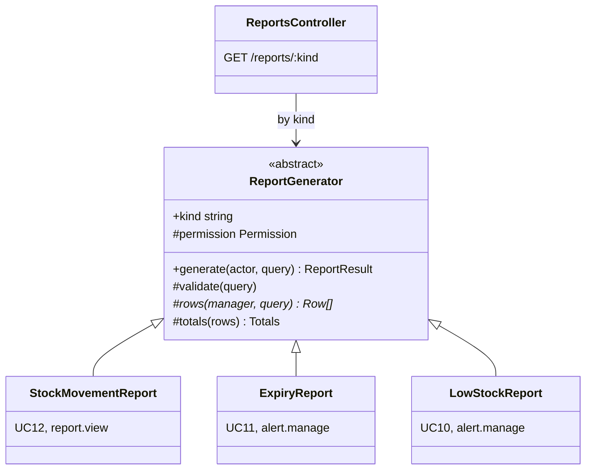

# UC12 — Produce a stock movement report

| | |
|---|---|
| **Owner** | Võ Hoàng Minh (C) |
| **Priority** | Must |
| **Primary actor** | Manager |
| **Status** | Design gate for #62 (week 7): decisions, interface and scenario table below |
| **Related rules** | BR05 (the report is built from the movements) |
| **Requirements** | FR-37, FR-39, NFR-02 |
| **Decisions** | DEC-06 (definition), DEC-05 (a billed dispensing counts once), DEC-04 (returns go to quarantine), decision 10 (business day) |

## Goal

For a chosen period, the manager sees per medicine how much came in, went out
to patients, came back, was released, written off, destroyed or adjusted, and
what was left, so they can see what moves and what sits on the shelf. Every
figure traces back to stock movements and the figures add up. It is a
quantity report, not revenue or inventory turnover (DEC-06).

## Preconditions

- The manager holds `report.view`.

## Postconditions

- **Success:** the report is shown. Producing it changes no data.
- **Failure:** an error is shown; no data changes.

## Definition (DEC-06)

The report reads **stock movements only**. Under DEC-05 a prescription
medicine leaves stock once, by its `DISPENSE` movement, and billing it writes
no movement, so it is counted once by construction.

Per medicine, over *from*–*to* (business days in Asia/Ho_Chi_Minh, both
included):

| Column | From movements of type | Note |
|---|---|---|
| Opening | all, before *from* | Total of all three stock states |
| Received | `RECEIPT` | |
| Dispensed | `DISPENSE` | Shown positive |
| Sold | `SALE` | Shown positive |
| Returned into quarantine | `RETURN` | |
| Released | `RELEASE` | Back to sellable stock (FR-46) |
| Rejected | `REJECT` | Quarantine → pending destruction |
| Written off | `WRITE_OFF` | Sellable → pending destruction |
| Destroyed | `DESTROY` | Shown positive |
| Adjusted | `ADJUSTMENT` | With sign |
| Closing | all, up to *to* | Total, and split into sellable / quarantine / pending destruction |
| **Net quantity issued** | | Dispensed + Sold − Released |
| Cost of net issued | | Each movement × its batch's unit cost, netted the same way; labelled "cost, not revenue" |

A reversal (`reversesMovement` set) is counted in the column of the movement
it reverses, with the opposite sign.

**Check every row must pass.** On total stock, release, reject and write-off
only move stock between states, so:
Closing = Opening + Received − Dispensed − Sold + Returned − Destroyed + Adjusted.
The system computes Closing independently and flags any row where the two
differ; a difference means a defect.

## Main flow

1. The manager opens *Reports → Stock movement*.
2. The system shows a form: from and to dates (default: first day of the
   current month to today) and an optional category.
3. The manager sets the period and runs the report.
4. The system validates the period (A1).
5. The system computes the columns for each medicine that has an opening
   balance or a movement in the period, and the totals.
6. The system shows the table sorted by cost of net issued, highest first,
   with the period, when it was produced and by whom.
7. The manager opens a row.
8. The system lists the movements behind it: date, type, batch, quantity per
   state, user and source document.

## Alternative and error flows

| ID | At step | Condition | What the system does | Ends in |
|---|---|---|---|---|
| A1 | 4 | A date is missing or *from* is after *to* | Error on the field | Step 3 |
| A2 | 5 | No medicine has stock or movements in the period | "No stock or movements in this period" | End |
| A3 | 5 | The check fails for a row | The row is shown with a warning and the mismatch is logged | Step 6 |
| A4 | 1 | The user lacks `report.view` (Pharmacist, Cashier) | 403 from the service (TC-28) | Failure |

## Functional requirements

| ID | Requirement (short form) | Test cases |
|---|---|---|
| FR-37 | Stock movement report for a date range: per medicine opening, received, dispensed, sold, returned into quarantine, released, written off, destroyed, adjusted, closing, and net issued = dispensed + sold − released; cost at batch unit cost, labelled not revenue. | TC-23 |
| FR-39 | Permission checked in the service on every request. | TC-28, TC-53 |
| NFR-02 | One month over 10,000 movements in at most 3 seconds. | TC-29 |

TC-23 compares the report with a hand calculation over two months that share
a boundary day, with sales, returns and releases.

## Decisions for the build

The open questions of the spec, settled for #62 as assumptions; each can be
changed in one place.

| Question | Taken for the build | Why |
|---|---|---|
| Opening and closing | Total of the three stock states, so the row check holds; closing is also split by state. | Open question 1 |
| The *Rejected* column | Shown, so every movement type has a column and the figures can be traced. | Open question 2 |
| Export | Not built (FR-43, *Could*). | Open question 3 |
| Which day a movement belongs to | Its `occurredAt` in Asia/Ho_Chi_Minh: `(occurredAt AT TIME ZONE 'Asia/Ho_Chi_Minh')::date`, so 23:30 belongs to that day and 00:30 to the next. | Decision 10, TC-23 |
| Reversals | Summing each movement's signed deltas by its type already counts a reversal in the column of what it reverses with the opposite sign: a reversal keeps the original type and negates the deltas (BR05). | Spec definition |
| Cost of net issued | Per movement, quantity × its batch's `unitCost`, summed as `numeric` in SQL (no floats) and sent as a decimal string, labelled *cost, not revenue*. | DEC-06 |
| Period | Both dates required, *from* ≤ *to*, *to* not after today, at most 366 days. | A1; NFR-02 sizes one month |
| Returns before UC08 | The *Returned* and *Released* columns read RETURN and RELEASE movements whenever they exist; until UC08 is on `main` they are 0 on real data. Tests post them through the ledger. | Plan W07-C2: "exports first, returns after B1" |
| Polymorphic reports (D14) | An abstract `ReportGenerator` with a template method `generate(actor, query)`: check the permission, validate the query, load the rows (`rows()`, abstract), add totals, stamp who and when. Three kinds: `StockMovementReport` (UC12, `report.view`), `ExpiryReport` (UC11, `alert.manage`) and `LowStockReport` (UC10's rule as a report, `alert.manage`). One route serves them all by kind, and one screen component shows any of them. | Class diagram part 2, decision D14 |

## Interface (for #62)

| Route | Permission | Response |
|---|---|---|
| `GET /api/reports/stock-movement?from=&to=&categoryId=` | `report.view` | `{ kind, period: { from, to }, producedAt, producedBy, rows: [{ medicine: { id, code, name }, opening, received, dispensed, sold, returned, released, rejected, writtenOff, destroyed, adjusted, closing: { total, sellable, quarantine, pendingDestruction }, netIssued, costNetIssued, checkOk }], totals }`, sorted by `costNetIssued` descending |
| `GET /api/reports/stock-movement/medicines/:id?from=&to=` | `report.view` | The movements behind one row: date, type, batch, deltas per state, user, source document (step 8) |
| `GET /api/reports/:kind` | per kind | `low-stock` and `expiry` through the same route and the same screen component |

Errors use the existing format: 400 on `from` / `to` / `categoryId` or an
unknown `kind`, 403.

On screen: *Stock control & reports* gets a **Stock movement** tab (period,
category, *Run*, the table with totals, a warning on any row whose check
fails, and the movements of a row). Wireframes: Tiến, #154.

## Scenario table

Every row becomes an automated test named in the last column; the rows with
a TC are also run by hand (by Duy Anh).

| ID | Kind | Scenario | Expected | Test |
|---|---|---|---|---|
| S01 | Normal | TC-23: two months sharing a boundary day, with receipts, dispensing, sales, a return released and one rejected, a write-off, an adjustment | Every column equals the hand calculation kept in the test; net issued = dispensed + sold − released | UC12-01, TC-23 |
| S02 | Invariant | Every row of S01 and of the seeded data | Closing = opening + received − dispensed − sold + returned − destroyed + adjusted; `checkOk` true | UC12-02 |
| S03 | Edge | A movement at 23:30 and one at 00:30 Asia/Ho_Chi_Minh around the period's end | The 23:30 one is in the period, the 00:30 one is not | UC12-03 |
| S04 | Edge | A sale reversed inside the period | *Sold* is reduced by the reversed quantity; net issued too | UC12-04 |
| S05 | Edge | A dispensing billed in UC07 | Counted once, as dispensed; billing adds nothing (DEC-05) | UC12-05, TC-52 |
| S06 | Normal | Cost of net issued over two batches with different unit costs | Σ quantity × unit cost, as a decimal string | UC12-06 |
| S07 | Normal | Category filter; sorting | Only that category; highest cost first | UC12-07 |
| S08 | Error | No *from*; *from* after *to*; *to* in the future; more than 366 days | 400 on the field | UC12-08 |
| S09 | Edge | A period with no stock and no movement | `rows: []` | UC12-09 |
| S10 | Normal | Open a row | Its movements in time order with type, batch, deltas, user and source | UC12-10 |
| S11 | Normal | `low-stock`, `expiry` and `stock-movement` through `GET /reports/:kind` | Each answers with its own rows and the same envelope; an unknown kind is 400 | UC12-11 |
| S12 | Error | A pharmacist or a cashier asks for the report | 403 | UC12-12, TC-28 |
| S13 | Performance | One month over 10,000 movements | ≤ 3 s | TC-29 (week 8, by hand) |
