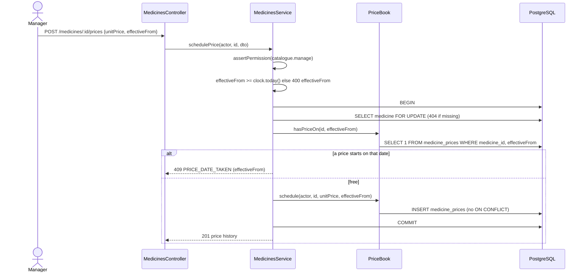

# UC13 — Manage medicine prices (Should)

| | |
|---|---|
| **Owner** | Võ Việt Tiến (A) |
| **Priority** | Should. The week 7 Must-core gate passed (#233), so it is built in week 8 (#103); in the cut order (`tuan-08.md`) it goes second, after UC15 |
| **Primary actor** | Manager |
| **Status** | Design gate for #103. Price history is already stored by UC01 (`PriceBook`, PR #97) and a sale already takes the price in force on its date; scheduling, cancelling and the history screen are new |
| **Related rules** | BR09 |
| **Requirements** | FR-04 |
| **Decisions** | Decision 12 (a sale is valued at the price in force on the sale date) |

## Goal

The manager plans price changes ahead and can always see which price applied
on any day, so a past sale or report never changes when a price does.

## Preconditions

- The manager is signed in; the role holds `catalogue.manage`.
- The medicine exists (active or not).

## Postconditions

- **Success:** the new price is stored with its effective date and the
  manager who set it; earlier prices are kept. No stock moves.
- **Failure:** nothing is saved.

## Main flow — schedule a price (FR-04)

1. In *Catalogue › Medicines* the manager opens **Prices** on a medicine. A
   drawer lists its prices, newest first: effective from, price, state
   (*Scheduled*, *In force*, *Past*), set by, and when it was set.
2. The manager enters a price and an effective date of today or later, then
   **Schedule price**.
3. The system checks the fields, locks the medicine, checks that no price
   starts on that date, and stores the new price.
4. The drawer shows the new row as *Scheduled* (or *In force* if it starts
   today). The medicine list keeps showing the price in force today.

## Main flow — cancel a scheduled price

1. In the drawer, the manager picks **Cancel** on a *Scheduled* row and
   confirms.
2. The system removes the row. No sale has used it, because it was not yet in
   force, so BR09 is unaffected.

## Alternative and error flows

| ID | At step | Condition | What the system does |
|---|---|---|---|
| A1 | Schedule 3 | Price not a whole number of VND, or below 1 | 400 on `unitPrice`; nothing saved |
| A2 | Schedule 3 | Effective date not a date, or before today (business date) | 400 on `effectiveFrom`; nothing saved |
| A3 | Schedule 3 | A price already starts on that date (today's or a scheduled one) | 409 `PRICE_DATE_TAKEN` on `effectiveFrom`; nothing saved. Today's price is still changed through *Edit* (UC01) |
| A4 | Cancel 2 | The price is in force or past (`effectiveFrom` ≤ today) | 422 `PRICE_ALREADY_IN_FORCE`; nothing removed |
| A5 | Any | Unknown medicine or price, or a price of another medicine | 404 |
| A6 | Any | The user lacks `catalogue.manage` | 403 |

## Decisions for the build

1. **Scheduling is its own command.** UC01's *Edit* keeps changing today's
   price as it does now (FR-03: a second change on the same day replaces that
   day's price). UC13 never overwrites a row, so a scheduled price is never
   silently replaced.
2. **"Today" is the business date** from `Clock` (DEC-01), the same date a sale
   uses to read its price, so a price scheduled for tomorrow is in force for
   the first sale of tomorrow.
3. **A scheduled price can be cancelled until it starts.** Without that, a
   wrong future price could not be corrected (A3 refuses a second price on the
   same date). A price in force or past is never removed or edited (BR09).
4. **Lock order:** the medicine row `FOR UPDATE`, as UC01's edit does, then the
   date check and the insert. The unique index
   `uq_medicine_price_effective_from` is the backstop; its violation is
   reported as A3.
5. **No request ID.** A repeated schedule is refused by A3 and a repeated
   cancel gets 404, so a retry can never apply twice.
6. **No migration.** `medicine_prices` already has `effectiveFrom`, `set_by_id`
   and `createdAt`.
7. **Not in this build:** editing a scheduled price (cancel and schedule
   again); an audit log entry for price changes, which is added when UC15's
   `AuditService` (#236) is on `main`.

## Interface

All routes need `catalogue.manage`. Money travels as a string, like every
other price.

| Route | Request | Response |
|---|---|---|
| `GET /api/medicines/:id/prices` | — | 200 `{ medicine: { id, code, name }, today, prices: [{ id, effectiveFrom, unitPrice, state: 'scheduled' \| 'in_force' \| 'past', setBy: { id, fullName }, createdAt }] }`, newest `effectiveFrom` first; exactly one row is `in_force` once the medicine has a price on or before today |
| `POST /api/medicines/:id/prices` | `{ unitPrice: integer ≥ 1, effectiveFrom: 'YYYY-MM-DD' }` | 201, the same body as `GET` (the whole history) · 400 `unitPrice` / `effectiveFrom` · 404 · 409 `PRICE_DATE_TAKEN` |
| `DELETE /api/medicines/:id/prices/:priceId` | — | 204 · 404 · 422 `PRICE_ALREADY_IN_FORCE` |

## Sequence — schedule a price

Cancelling follows the same lock: medicine `FOR UPDATE`, then the price row of
that medicine (404 otherwise), then 422 if `effectiveFrom` ≤ today, otherwise
`DELETE`.

## Scenario table

| ID | Kind | Scenario | Expected | Test |
|---|---|---|---|---|
| S01 | Normal | Schedule 1.500 ₫ for PARA500 from tomorrow | 201; the history shows it *Scheduled* and the old price *In force*; the medicine list still shows the old price | UC13-01 |
| S02 | Normal | Schedule for tomorrow, move the clock to tomorrow, sell PARA500 over the counter | The sale line carries the new price (BR09, decision 12) | UC13-02, TC-40 |
| S03 | Normal | Sell, then change today's price (UC01) and schedule another for tomorrow | The past sale line and the movement report keep the old figures | UC13-03, TC-41 |
| S04 | Error | Price 10.5, 0 and −5; date yesterday and `2026-13-01` | 400 on `unitPrice` three times, 400 on `effectiveFrom` twice; nothing saved | UC13-04 |
| S05 | Error | Schedule for today when today already has a price; schedule a second price for a date already scheduled | 409 `PRICE_DATE_TAKEN` on `effectiveFrom` both times; the existing prices unchanged | UC13-05 |
| S06 | Normal | Cancel a scheduled price | 204; gone from the history; sales still read the price in force | UC13-06 |
| S07 | Error | Cancel today's price; cancel a past price; cancel a price of another medicine | 422 `PRICE_ALREADY_IN_FORCE` twice; 404; nothing removed | UC13-07 |
| S08 | Edge | Two managers schedule the same date at the same time | One 201, the other 409; one row | UC13-08 |
| S09 | Access | Pharmacist and cashier on the three routes | 403 each | access matrix |
| S10 | Normal | History of a medicine with past, current and scheduled prices | Newest first; one *In force*; set by and set at filled | UC13-09 |

Manual: **TC-40** (S02) and **TC-41** (S03), run by Minh.

## Functional requirements

| ID | Requirement | Test cases |
|---|---|---|
| FR-04 | Schedule a new price with an effective date while keeping all earlier prices, and value each sale at the price in force on the sale date (BR09). | TC-40, TC-41 |

## Screen

*Catalogue › Medicines* gets a **Prices** action per row, which opens the
drawer above. Wireframes:
[`catalogue-prices.png`](../../diagrams/wireframes/catalogue-prices.png)
(normal, field error, date taken, cancel confirmation, only one price).

Source: Proposal v1.1, Appendix A, Table A.13.
