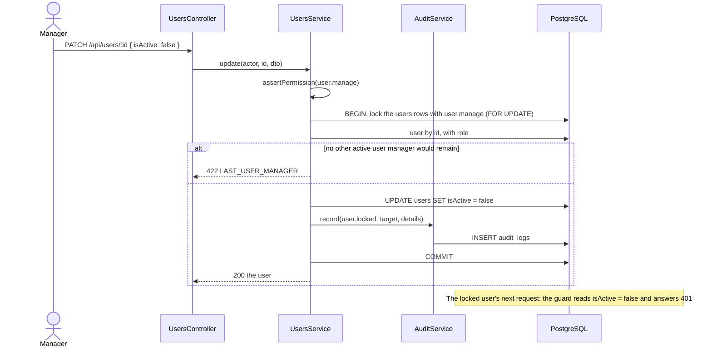

# UC15 — Manage users, roles and permissions

| Field | Value |
|---|---|
| **ID** | UC15 |
| **Owner** | Minh (C) |
| **Priority** | Should — started because the week 7 Must-core gate passed (#63, 30/10) |
| **Primary actor** | Manager |
| **Status** | Agreed for the build (#105); design gate in this file |
| **Related rules** | none of BR01–BR11; NFR-05 (security) |
| **Requirements** | FR-40, FR-41 |
| **Decisions** | "The last user manager" below; Table 2.4 of the Proposal (roles) |

## Goal

The manager gives each member of staff their own account with the right
role, takes access away when someone leaves, and can see afterwards who did
what. Until now the three sample accounts came from the seed and could only
be changed in the database (TC-42 had to lock an account by SQL).

## Preconditions

- The manager is signed in and has `user.manage` (Table 2.4: manager only).
- Roles and permissions exist (seeded from `ROLE_PERMISSIONS`).

## Postconditions

- **Users:** a new or changed account takes effect on that user's next
  request; the guard reads the user, role and permissions from the database
  on every request (UC16), so a lock or a role change does not wait for the
  token to expire.
- **Audit:** every change below writes one `audit_logs` row with the action,
  the user who did it, the target and the time (FR-41).
- **Stock:** none. UC15 moves no stock.

## Main flow — add a user (FR-40)

1. The manager opens *Users & roles → Users* and chooses *New user*.
2. The manager enters username, full name, role and a temporary password,
   and repeats the password.
3. The system checks the fields (A1, A2), stores the password as a bcrypt
   hash (cost 10, NFR-05) and creates the user as active.
4. The system writes `user.created` to the audit log and shows the user in
   the list. The temporary password is shown nowhere again.

## Main flow — change, lock or reset (FR-40)

1. The manager opens a user.
2. The manager changes the full name or the role, locks or unlocks the
   account, or sets a new temporary password.
3. The system applies the change (A3, A4), writes `user.updated`,
   `user.role_changed`, `user.locked`, `user.unlocked` or
   `user.password_reset`, and shows the user.

A locked user's next request gets 401 and sign-in shows "This account is
locked. Ask the manager." (UC16, TC-42).

## Main flow — change what a role may do

1. The manager opens *Users & roles → Roles*.
2. The system lists the three roles with their permissions, each with its
   description (`PERMISSION_DESCRIPTIONS`).
3. The manager ticks or unticks permissions of a role and saves (A4).
4. The system replaces the role's permissions, writes
   `role.permissions_changed` with what was added and removed, and the change
   applies to every user of that role on their next request.

## Main flow — read the audit log (FR-41)

1. The manager opens *Users & roles → Audit log*.
2. The system lists entries newest first: time, user, action, target,
   details, 50 per page, filtered by period, user and action.

Actions recorded: `auth.login`, `auth.login_failed` (the username tried,
never the password), `auth.logout`, the user and role actions above,
`stock_take.approved` (UC09), and the price change of UC13
(`price.changed`, written by Tiến's #103 through the same service).

## Alternative and error flows

| ID | At step | Condition | What the system does | Ends in |
|---|---|---|---|---|
| A1 | Add 3 | A field is empty or too long; the passwords differ; the password is shorter than 8 characters | 400 next to the field | Add 2 |
| A2 | Add 3 | The username is taken, compared without letter case (as at sign-in) | 409 `USERNAME_TAKEN` on `username` | Add 2 |
| A3 | Change 3 | The manager locks their own account or changes their own role, and no other active user has `user.manage` | 422 `LAST_USER_MANAGER`, nothing saved | Change 2 |
| A4 | Change 3 / Role 4 | Any other change (locking, a role change, removing `user.manage` from a role) would leave no active user who has `user.manage` | 422 `LAST_USER_MANAGER`, nothing saved | Change 2 |
| A5 | any | Not a manager | 403 (FR-39, TC-28, TC-53) | — |
| A6 | Change 1 | Unknown user or role id in the path | 404 | — |

## Decisions for the build

| Question | Taken for the build | Why |
|---|---|---|
| The last user manager: can the system lose it? | No. Any change that would leave no active user whose role has `user.manage` is refused (`LAST_USER_MANAGER`): locking, changing role, or removing the permission from a role. That covers locking yourself. | Otherwise only a database edit could get back in |
| Can roles be added or deleted? | No. The three roles of Table 2.4 stay; their permissions can change. | The proposal fixes three roles; the screens and tests assume them |
| Delete a user? | No. Lock instead. Users are referenced by every movement, sale and stock take. | BR05: history must keep who did it |
| Password rules | At least 8 characters, at most 72 (the bcrypt limit), not trimmed. The manager sets a temporary password and tells the user; there is no e-mail. | NFR-05; no mail server in scope |
| Username | 3–32 characters, letters, digits, `.`, `_`, `-`; unique without letter case. | Matches sign-in (UC16) |
| What the audit log stores | `action`, `entityName`, `entityId`, `details` (a short JSON text: e.g. the old and new role), `performedBy` (null for a failed sign-in), `occurredAt`. Never a password or its hash. | FR-41; the table exists since #95 |
| Where audit rows are written | `AuditService.record(manager, actor, action, target, details)`, called inside the same transaction as the change, so a rolled-back change leaves no row. | One way to write; consistent with the ledger |
| Who sees the log | `user.manage` (manager). | Table 2.4 |

## Interface

| Route | Permission | Body / response |
|---|---|---|
| `GET /api/users` | `user.manage` | `[{ id, username, fullName, role: { code, name }, isActive, lastLoginAt, createdAt }]` |
| `POST /api/users` | `user.manage` | `{ username, fullName, roleCode, password, passwordConfirm }` → 201 the user |
| `PATCH /api/users/:id` | `user.manage` | `{ fullName?, roleCode?, isActive? }` → the user |
| `POST /api/users/:id/password` | `user.manage` | `{ password, passwordConfirm }` → 204 |
| `GET /api/roles` | `user.manage` | `[{ code, name, permissions: [code], userCount }]` and `allPermissions: [{ code, description }]` |
| `PUT /api/roles/:code/permissions` | `user.manage` | `{ permissions: [code] }` → the role |
| `GET /api/audit-logs?from=&to=&userId=&action=&page=` | `user.manage` | `{ items: [{ id, occurredAt, action, entityName, entityId, details, performedBy: { id, fullName } \| null }], total }` |

Errors use the existing format: 400 per field, 403, 404, 409
`USERNAME_TAKEN`, 422 `LAST_USER_MANAGER`.

On screen: *Users & roles* (today a placeholder for the manager) gets three
tabs, **Users**, **Roles**, **Audit log**. Wireframes: Tiến (§7 of
`ui-design.md`).

## Sequence — lock a user

Locking the rows of every active user manager before counting them means two
managers locking each other at the same moment cannot both succeed and leave
nobody (A4).

## Scenario table

| ID | Kind | Scenario | Expected | Test |
|---|---|---|---|---|
| S01 | Normal | Add a pharmacist with a valid temporary password | 201; can sign in with it; password stored as bcrypt cost 10; `user.created` logged | UC15-01, TC-44 |
| S02 | Error | Username `Pharmacist` when `pharmacist` exists; password of 7 characters; passwords differ | 409 `USERNAME_TAKEN`; 400 on `password`; 400 on `passwordConfirm` | UC15-02 |
| S03 | Normal | Change a cashier to pharmacist | Next request has the pharmacist's permissions without signing in again; `user.role_changed` with old and new role | UC15-03, TC-44 |
| S04 | Normal | Lock a user, then unlock | Their token gets 401 at once; sign-in says *locked*; after unlock they sign in | UC15-04, TC-44 |
| S05 | Error | With one manager: they lock themselves; change their own role; remove `user.manage` from Manager | 422 `LAST_USER_MANAGER` each time; nothing changed | UC15-05 |
| S06 | Normal | Reset a password | Old password refused, new one works; `user.password_reset` logged, no password in `details` | UC15-06 |
| S07 | Normal | Give the cashier role `stock.view` off, then on | The cashier's stock screen gets 403, then works again; `role.permissions_changed` lists the change | UC15-07 |
| S08 | Normal | Sign in, a wrong password, sign out | `auth.login`, `auth.login_failed` (username only), `auth.logout` | UC15-08 |
| S09 | Normal | Approve a stock take | One `stock_take.approved` row | UC15-09 |
| S10 | Error | A pharmacist or cashier calls any route above | 403 | UC15-10, TC-28, TC-53 |
| S11 | Edge | Two managers lock each other at the same time | One succeeds, the other gets 422; one active user manager remains | UC15-11 |

TC-44 is run by hand by Duy Anh.

## Functional requirements

| ID | Requirement (short form) | Test cases |
|---|---|---|
| FR-40 *(S)* | Create users, assign a role, reset a password, lock or unlock; a locked user cannot sign in. | TC-44 |
| FR-41 *(S)* | Audit log of sign-ins, user and role changes, price changes and approved stock takes, with user and time. | TC-44 |
